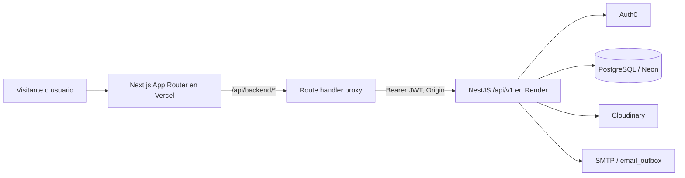
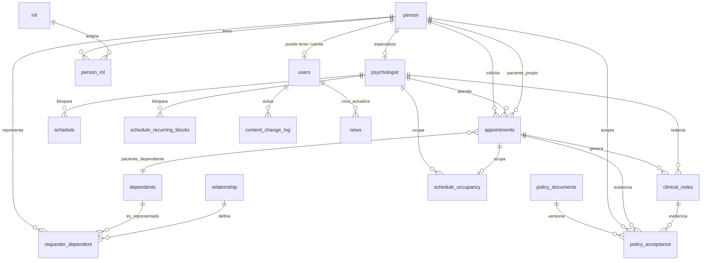

# SUPERPROMPT - SANA

Especificación completa del sistema SANA (Fundación Dejando Huellas Felices).
Archivo generado por `superprompt/build.py` a partir de `superprompt/secciones/`. No editar directamente.

## Contenido

- [0. Instrucciones de ejecución](#0-instrucciones-de-ejecución)
- [1. Contexto y problema](#1-contexto-y-problema)
- [2. Alcance](#2-alcance)
- [3. Roles y permisos](#3-roles-y-permisos)
- [4. Stack tecnológico y convenciones](#4-stack-tecnológico-y-convenciones)
- [5. Arquitectura y patrones de diseño](#5-arquitectura-y-patrones-de-diseño)
- [6. Modelo de datos](#6-modelo-de-datos)
- [7. Épicas, historias de usuario y criterios de aceptación](#7-épicas-historias-de-usuario-y-criterios-de-aceptación)
- [8. Requisitos no funcionales](#8-requisitos-no-funcionales)
- [9. Contratos de la API](#9-contratos-de-la-api)
- [10. Integraciones externas](#10-integraciones-externas)
- [11. Interfaz de usuario](#11-interfaz-de-usuario)
- [12. Pruebas y aseguramiento de calidad](#12-pruebas-y-aseguramiento-de-calidad)
- [13. Documentación a generar](#13-documentación-a-generar)
- [14. Uso responsable de IA](#14-uso-responsable-de-ia)
- [15. Plan de ejecución](#15-plan-de-ejecución)

---

# 0. Instrucciones de ejecución

## 0.1 Objetivo

Construir el sistema SANA (plataforma web de la Fundación Dejando Huellas Felices, Popayán) a partir de esta especificación: código fuente de frontend y backend, esquema y migraciones de base de datos, pruebas automatizadas, configuración de despliegue y documentación técnica y de usuario.

## 0.2 Terminología normativa

- DEBE / NO DEBE: requisito obligatorio.
- DEBERÍA: requisito recomendado; toda desviación se justifica en `docs/decisiones.md`.
- PUEDE: opcional.

## 0.3 Reglas generales

- R-01. Esta especificación es la única fuente de requisitos. Lo que no esté especificado NO DEBE implementarse sin confirmación.
- R-02. El alcance se limita a lo definido en la sección 2. Las funcionalidades excluidas NO DEBEN implementarse aunque aparezcan en otros documentos del proyecto.
- R-03. El stack, las versiones y las convenciones de la sección 4 son obligatorios. No se DEBE sustituir ni agregar tecnologías sin confirmación.
- R-04. Una HU se considera implementada solo cuando todos sus escenarios Gherkin (sección 7) pasan como pruebas automatizadas.
- R-05. La ejecución sigue el orden de fases de la sección 15. No se DEBE iniciar una fase sin cerrar la anterior.
- R-06. El sistema trata datos personales sensibles de menores de edad (Ley 1581 de 2012). Los requisitos de la sección 8 aplican a todas las fases.
- R-07. Idioma: código (identificadores, nombres de archivos y tablas) en inglés; interfaz, mensajes de error, documentación y mensajes de commit en español.
- R-08. NO DEBEN usarse datos reales de consultantes en desarrollo, pruebas ni datos semilla.

## 0.4 Marcadores de la especificación

| Marcador | Significado | Acción requerida |
|---|---|---|
| `[CONFIRMAR: ...]` | Decisión abierta que requiere al usuario | Detener la tarea dependiente, formular la pregunta y esperar respuesta |
| `[PENDIENTE: ...]` | Dato aún no definido por el equipo | Solicitar el dato al usuario antes de usarlo; no asumir valores |

## 0.5 Protocolo de confirmación

Al encontrar un marcador `[CONFIRMAR]` o `[PENDIENTE]`, o antes de ejecutar una operación listada en 0.6:

1. Suspender únicamente las tareas que dependen de la respuesta. Las tareas independientes PUEDEN continuar.
2. Formular la pregunta indicando: sección de origen, contexto mínimo y, cuando existan, opciones numeradas con su impacto técnico y la opción recomendada.
3. Las preguntas de una misma fase DEBERÍAN agruparse en un solo bloque.
4. Si el usuario delega la decisión, aplicar la opción recomendada.
5. Registrar cada decisión en `docs/decisiones.md`:

```
| Fecha (AAAA-MM-DD) | Sección | Pregunta | Decisión | Decidido por |
```

## 0.6 Operaciones que requieren confirmación previa

- Crear, modificar o ejecutar migraciones de base de datos.
- Eliminar archivos, tablas o registros.
- Instalar dependencias no listadas en la sección 4.
- Configurar credenciales, secretos o servicios externos (Google OAuth, correo, WhatsApp, pasarela de pago).
- Desplegar a cualquier entorno.
- Cerrar una fase.

## 0.7 Repositorio existente

Si el repositorio de destino contiene código:

1. Analizar el código existente contra esta especificación.
2. Reportar una tabla con tres columnas: implementado y conforme; implementado y no conforme (con la diferencia); no implementado.
3. [CONFIRMAR: conservar el código existente y completar lo faltante, o regenerar desde cero.]

## 0.8 Informe de cierre de fase

Al finalizar cada fase se DEBE entregar:

```
FASE <n> - <nombre>
Implementado: <componentes y HU>
Pruebas: <aprobadas>/<totales>; HU cubiertas: <lista>
Documentación modificada: <archivos>
Riesgos y pendientes: <lista>
Decisiones requeridas: <lista>
```

La fase siguiente se inicia solo con aprobación explícita del usuario.

---

# 1. Contexto y problema

## 1.1 Organización

Fundación Dejando Huellas Felices: entidad sin ánimo de lucro de Popayán, Colombia, que presta atención psicológica a niños, niñas y adolescentes.

## 1.2 Situación actual

[PENDIENTE: trasladar la definición del problema de la Entrega 1. Incluir: herramientas actuales para agenda (calendarios externos), registro de consultantes, publicación de contenido y recepción de donaciones; problemas operativos asociados a cada una.]

## 1.3 Solución

SANA es una plataforma web integral compuesta por:

| Módulo | Épica | Descripción |
|---|---|---|
| Usuarios y acceso | HE-01 | Autenticación con Google OAuth 2.0 y autorización por roles |
| Consultantes | HE-02 | Registro y consulta de fichas de consultantes y acudientes |
| Agenda | HE-03 | Gestión de citas por profesional; reemplaza los calendarios externos |
| Contenido institucional | HE-04 | Edición del contenido del sitio público |
| Donaciones | HE-05 | Configuración y publicación de medios de donación; registro de donaciones |
| Reportes | HE-06 | Reportes de recaudo |

## 1.4 Actores

- Usuarios autenticados: ver sección 3.
- Visitante (no autenticado): acceso al sitio público y a la información de donaciones.

## 1.5 Restricciones

- Proyecto académico (Universidad del Cauca), Scrum, tres sprints.
- Costo de infraestructura mínimo: se priorizan planes gratuitos o de bajo costo.
- [PENDIENTE: fechas de cierre de cada sprint y de la entrega final.]

---

# 2. Alcance

## 2.1 Incluido

Épicas HE-01 a HE-06 con las historias de usuario de la sección 7.

## 2.2 Excluido

- EX-01. Módulos 8, 9 y 10 del documento de requisitos original. [PENDIENTE: nombre y descripción de cada módulo para que puedan identificarse.]
- EX-02. Flujo de solicitud de acceso con aprobación o rechazo. Descartado el 2026-09-11: el Administrador crea las cuentas directamente y asigna el rol en la misma operación.

## 2.3 Priorización

Método MoSCoW. [PENDIENTE: prioridad de cada HU (Must, Should, Could, Won't).]

## 2.4 Decisiones abiertas

- DA-01. [CONFIRMAR: un usuario puede tener varios roles (el modelo de datos ya lo admite). Mecanismo de interfaz: (1) un rol activo a la vez con selector de rol; (2) todos los roles activos simultáneamente, con desactivación temporal por parte del Administrador.]
- DA-02. [CONFIRMAR: el rol Psicólogo es exclusivo (no combinable con Asistente ni Marketing) para restringir el acceso a información clínica.]

---

# 3. Roles y permisos

## 3.1 Roles vigentes en el código

Los nombres de rol que intercambian el frontend y backend son los valores exactos en minúscula:

| Código | Valor técnico | Nombre visible | Responsabilidad según las pantallas actuales |
|---|---|---|---|
| ADMIN | `administrador` | Administrador | Gestiona usuarios y contenido institucional; consulta logs de seguridad. También puede acceder al layout general de personal. |
| SECRETARY | `secretario` | Asistente administrativa / secretaria | Gestiona solicitudes y agenda, y administra fichas administrativas de consultantes. |
| PSYCHOLOGIST | `psicologo` | Psicólogo | Gestiona citas asignadas, disponibilidad y atenciones/notas clínicas. |
| MARKETING | `marketing` | Marketing y diseño | Administra contenido, noticias, banners y galería. |
| REQUESTER | `consultante` | Consultante | Consulta su cuenta, solicitudes y citas propias. |
| PENDING | `pendiente` | Cuenta pendiente | Es un estado/rol reconocido por el backend, pero no tiene acceso habilitado a las pantallas internas identificadas. |
| — | Sin sesión | Visitante | Accede al sitio público y puede enviar una solicitud pública de cita. |

El administrador puede asignar los cuatro roles internos (`administrador`, `secretario`, `psicologo`, `marketing`). El rol `consultante` se origina en el flujo público, no en el catálogo de roles del panel. El código no debe tratar `pendiente` como un rol interno autorizado.

## 3.2 Autorización de pantallas del frontend

Las rutas siguientes son rutas de página Next.js. Los grupos entre paréntesis son grupos de organización y no forman parte de la URL:

| Pantallas / rutas | Acceso implementado |
|---|---|
| Sitio público: `/`, `/noticias`, `/noticias/:id`, `/solicitar-cita`, `/solicitar-cita/adulto`, `/solicitar-cita/menor`, `/solicitar-cita/confirmacion` | Público, sin sesión. El envío de cita se valida además en el backend. |
| `/usuarios`, `/usuarios/nuevo`, `/usuarios/:id/editar` | Solo `administrador`, exigido por el layout `(dashboard)` mediante `requireAdministrator`. |
| `/contenido/institucional`, `/contenido/noticias`, `/contenido/banners`, `/contenido/galeria` | `administrador` o `marketing`, exigido por el layout `(content)`. |
| `/solicitudes`, `/solicitudes/:id` | Solo `secretario`, exigido en cada página; el layout `(staff)` también requiere uno de `secretario`, `psicologo`, `administrador`. |
| `/calendario` | Solo `secretario`, exigido en la página y por el layout `(staff)`. |
| `/mis-citas`, `/mi-disponibilidad` | Solo `psicologo`, exigido en la página y por el layout `(staff)`. |
| `/consultantes`, `/consultantes/:id`, `/consultantes/:id/resumen`, `/registro-atencion/nuevo` | El layout `(staff)` permite `secretario`, `psicologo` o `administrador`. Las páginas de consultantes no agregan una restricción de rol más fina; el listado elige vista de psicólogo si el usuario tiene ese rol y, en otro caso, vista administrativa. La página de registro de atención tampoco restringe el rol individualmente. |
| `/mi-cuenta` | Solo `consultante`, exigido por el layout `(consultante)`. |
| `/panel` | Requiere sesión válida mediante `getCurrentUser`; redirige según rol a `/usuarios`, `/consultantes`, `/contenido/institucional`, `/mi-cuenta`, `/cuenta-pendiente` o `/acceso-restringido`. No es una pantalla de contenido propia. |
| `/iniciar-sesion`, `/sesion-expirada`, `/acceso-restringido`, `/cuenta-pendiente` | Pantallas de autenticación/estado. |

El menú lateral solo controla qué enlaces se muestran; no es un control de autorización. Las rutas deben continuar protegidas por servidor/layout y los endpoints backend deben validar sesión, rol y alcance del recurso.

## 3.3 Autorización de endpoints del backend

La API usa el prefijo `/api/v1`. En las tablas, `:id`, `:type`, `:appId` y otros parámetros representan segmentos dinámicos. Los métodos separados por coma aplican al endpoint indicado.

### 3.3.1 Endpoints públicos y de sesión

| Endpoint | Acceso |
|---|---|
| `GET /api/v1/`, `GET /api/v1/healthz` | Público; comprobación de servicio/salud. |
| `POST /api/v1/appointments/request` | Público; crea una solicitud de cita para la persona solicitante o un menor dependiente. |
| `GET /api/v1/policy/:type` | Público; obtiene el documento de política vigente. |
| `GET /api/v1/public/content`, `GET /api/v1/public/news`, `GET /api/v1/public/news/:id`, `GET /api/v1/public/banners`, `GET /api/v1/public/gallery-images` | Público; solo contenido publicado/activo, con limitación de solicitudes. |
| `GET /api/v1/auth/me`, `PATCH /api/v1/auth/terms`, `PATCH /api/v1/auth/psychologist-terms`, `DELETE /api/v1/auth/sessions/current` | Cualquier usuario con JWT válido. No hay `RolesGuard` ni rol explícito en estos métodos. El endpoint `psychologist-terms` no restringe el rol a psicólogo en el controlador actual. |
| `GET /api/v1/users/me`, `PATCH /api/v1/users/me` | Cualquier usuario autenticado con uno de estos roles: `administrador`, `secretario`, `psicologo`, `marketing`, `consultante`. Las reglas de campos editables se aplican en el servicio según los roles. |

### 3.3.2 Recursos protegidos por rol

| Recurso / endpoints | Rol(es) autorizados | Operaciones |
|---|---|---|
| `/users` | `administrador` | `GET /`, `GET /:id`, `POST /`, `PATCH /:id`, `PATCH /:id/status`, `DELETE /:id`: lista, consulta, crea, actualiza, cambia estado y elimina usuarios. |
| `/consultants` ficha administrativa | `secretario` | `GET /`, `GET /:id`, `POST /`, `PATCH /:id`: consulta y actualiza fichas administrativas de consultantes. |
| `/consultants` vista clínica propia | `psicologo` | `GET /mine`, `GET /:id/full`: consulta solo consultantes con citas propias asignadas y su ficha completa autorizada. |
| `/appointments` solicitudes | `secretario` | `GET /`, `GET /:id`, `GET /psychologists`, `GET /:id/psychologist-history`; `PATCH /:id/confirm`, `/assign`, `/discard`, `/status`: gestiona y confirma solicitudes, asigna psicólogo y consulta el historial de asignación. |
| `/appointments` propias del consultante | `consultante` | `GET /my-requests`, `PATCH /:id/cancel`: consulta y cancela/retira sus propias solicitudes/citas; el servicio restringe la operación a la identidad del usuario autenticado. |
| `/appointments` asignadas al psicólogo | `psicologo` | `GET /relationships`, `GET /my-appointments`, `GET /my-appointments/:id`, `PATCH /:id/complete`: consulta el catálogo de parentescos y citas propias asignadas, y marca una cita como realizada. El servicio valida la asignación al psicólogo. |
| `/schedule/me/blocks`, `/schedule/me/recurring-blocks` | `psicologo` | `GET`, `POST` en ambas rutas; `DELETE /me/blocks/:id` y `DELETE /me/recurring-blocks/:id`: administra su propia disponibilidad/bloqueos. |
| `/schedule/me/accept-terms`, `/schedule/me/terms-status` | `psicologo` | `POST` acepta los términos de agenda; `GET` consulta estado. |
| `/schedule/psychologists/:psychologistId/blocks`, `/schedule/psychologists/:psychologistId/calendar`, `/schedule/availability` | `secretario` | `GET`: consulta bloques, calendario y disponibilidad para coordinar citas. |
| `/clinical-notes/register-attention`, `/clinical-notes/appointment/:appId`, `/clinical-notes/consultant/:requesterId/history`, `/clinical-notes/:cnId`, `/clinical-notes/:cnId/audit` | `psicologo` | `POST` registra atención; `GET` consulta nota, historial y auditoría. El servicio también aplica control de acceso al registro/cita/consultante; el rol por sí solo no debe considerarse autorización suficiente sobre datos clínicos. |
| `/content-items` | `administrador`, `marketing` | `GET /`, `PATCH /`: consulta y edita contenido institucional de valor único (p. ej., misión y visión). |
| `/content-cards` | `administrador`, `marketing` | `GET /`, `POST /`, `PATCH /:id`, `DELETE /:id`: gestiona tarjetas/listas de contenido institucional. |
| `/news` | `administrador`, `marketing` | `GET /`, `POST /`, `PATCH /:id`, `PATCH /:id/status`, `PATCH /:id/pin`, `DELETE /:id`: administra noticias, publicación y fijación. |
| `/banners` | `administrador`, `marketing` | `GET /`, `POST /`, `PATCH /:id`, `PATCH /:id/activation`, `DELETE /:id`: administra banners. |
| `/gallery-images` | `administrador`, `marketing` | `GET /`, `POST /`, `PATCH /:id`, `PATCH /:id/status`, `DELETE /:id`: administra imágenes y estado de publicación de galería. |
| `/image-upload-signatures` | `administrador`, `marketing` | `POST /`: solicita firma para cargar imágenes. |
| `/security-logs` | `administrador` | `GET /`: consulta eventos de rechazo por rol, con filtros opcionales de usuario/fecha. |

En rutas protegidas, `OriginGuard` y `JwtAuthGuard` complementan la autorización según el controlador. El `RolesGuard` combina metadatos del método y de la clase; el metadato del método prevalece. Por tanto, las excepciones de autoservicio de `/users/me` autorizan los roles indicados aunque la clase completa esté restringida por defecto a administración.

## 3.4 Relación vigente entre pantalla y endpoint

El código actual es la definición aprobada del acceso. Los layouts y páginas determinan qué interfaz se puede navegar; el backend determina la autorización efectiva de datos y operaciones. Esta diferencia es intencional en las superficies siguientes y no autoriza a ampliar endpoints ni datos de respuesta.

| Superficie | Navegación implementada | Autorización efectiva vigente |
|---|---|---|
| Consultantes (`/consultantes`, detalle y resumen) | El layout `(staff)` permite `secretario`, `psicologo` y `administrador`; el listado selecciona vista de psicólogo cuando corresponde y administrativa en los demás casos. | Secretaría usa la ficha administrativa (`GET /consultants`, `/:id`); psicología usa `/mine` y `/:id/full` con comprobación de asignación. Administración puede entrar al layout, pero no cuenta con endpoint de ficha administrativa propio. |
| Registro de atención (`/registro-atencion/nuevo`) | Hereda acceso de layout de personal. | El registro y toda lectura de notas clínicas requieren `psicologo`; los demás roles reciben denegación del backend. |
| `/panel` | Exige sesión y redirige según el rol. | Es una ruta de decisión/navegación; no expone un recurso backend propio. |
| Términos de psicólogo | La interfaz de disponibilidad está reservada a `psicologo`. | `PATCH /auth/psychologist-terms` admite cualquier JWT válido porque el controlador no aplica `RolesGuard`; este es el permiso vigente del endpoint. Las rutas de agenda sí exigen `psicologo`. |

La UI nunca sustituye el control backend. Las comprobaciones de pertenencia/asignación y privacidad de datos se aplican en el servicio además del rol, incluso cuando una ruta de pantalla sea navegable por más de un rol.

## 3.5 Reglas de autorización

- AUT-01. La autorización efectiva se aplica en el backend en cada endpoint protegido. Ocultar enlaces o proteger un layout del frontend no sustituye guards, roles ni autorización a nivel de registro.
- AUT-02. Un usuario solo puede operar sobre recursos propios o asignados cuando así lo exige el dominio (p. ej., solicitudes del consultante, citas del psicólogo y notas clínicas); la validación debe derivar la identidad de la sesión/JWT, no confiar en un identificador enviado por el cliente.
- AUT-03. Los endpoints públicos se limitan a las operaciones expresamente marcadas como públicas; no deben entregar registros no publicados ni datos personales.
- AUT-04. El backend responde con denegación de autorización cuando falte el rol exigido. Los intentos autenticados con rol insuficiente se registran mediante `RolesGuard`; el acceso de lectura de logs se reserva a `administrador`.
- AUT-05. Cada inicio de sesión exitoso actualiza `user_last_login_at`.
- AUT-06. Una cuenta bloqueada o desactivada no puede iniciar sesión.
- AUT-07. Los roles de frontend y backend deben usar los mismos valores técnicos exactos. Cambios de roles/permisos requieren actualizar API, pantallas, menú, pruebas y esta matriz.

## 3.6 Alcance aún no implementado

- [PENDIENTE: definir roles y operaciones de donaciones, configuración de donaciones y reportes. No hay endpoints ni pantallas implementados que otorguen permisos para estas capacidades.]

---

# 4. Stack tecnológico y convenciones

## 4.1 Fuente de verdad y alcance

Esta sección describe el stack **realmente instalado**. No inferir dependencias, infraestructura ni servicios a partir de las historias de usuario. Donaciones, reportes, WhatsApp y OAuth social directo aparecen en requisitos, pero no tienen módulo, endpoint ni pantalla implementados; son pendientes, no parte del runtime actual.

## 4.2 Tecnologías instaladas

| Capa | Tecnología y versión declarada | Uso en SANA |
|---|---|---|
| Frontend | Next.js `16.3.8`, React/React DOM `19.2.8`, TypeScript `5` | App Router, páginas y proxy BFF. |
| Estilos/UI | Tailwind CSS `4`, PostCSS, CSS global; Lucide, React Big Calendar, date-fns, react-markdown | Diseño, iconos, agenda, fechas y Markdown limitado para noticias. |
| Autenticación web | `@auth0/nextjs-auth0` `4.30.0` | Sesión Next.js y access token reenviado a la API. |
| Backend | Node.js, NestJS `12.1.x`, TypeScript `6.0.2`, Express | API REST modular; puerto `3000` por defecto. |
| Persistencia | PostgreSQL/Neon, `pg` `8.23.0`, TypeORM `1.1.1` | Entidades y esquema SQL versionado. |
| Despliegue frontend | Vercel | Aplicación Next.js desplegada. |
| Despliegue backend | Render | API NestJS desplegada. |
| Seguridad | `jose`, Helmet, cookie-parser, bcrypt, Joi, class-validator/transformer | JWT Auth0, cabeceras, ambiente y DTOs. |
| Correo | Nodemailer `10.0.13` sobre SMTP | Cola durable `email_outbox`, reintentos y limpieza de payload enviado. |
| Imágenes | Cloudinary REST API, sin SDK | Firma de carga directa y verificación previa a persistir. |
| Pruebas | Vitest, Supertest y cobertura V8 | Unitarias, e2e y OWASP. |
| Calidad | Oxlint backend; ESLint Next frontend; Prettier backend | `npm run lint`; Prettier tiene script de escritura. |

No se declara versión de Node mediante `.nvmrc`, `engines` ni `.tool-versions`. Fijarla antes de CI/producción; no asumir la versión local.

## 4.3 Topología y rutas técnicas

```text
Navegador -> Next.js en Vercel (:5173 en desarrollo)
              /api/backend/* -> route handler BFF
                                -> BACKEND_API_URL/api/v1/* + Bearer JWT + Origin
           NestJS en Render (:3000 por defecto) -> TypeORM -> PostgreSQL/Neon
                                      -> Auth0, Cloudinary, SMTP/email_outbox
```

- El backend fija `api/v1` con `app.setGlobalPrefix`; su contrato empieza por `/api/v1`, no `/api`.
- El navegador consume `/api/backend/*`, no la URL del backend. El BFF añade el access token Auth0 disponible y `Origin`; no reenvía cookies de sesión al backend.
- Los endpoints privados requieren `Authorization: Bearer <access-token>`. El backend actual no lee un JWT propio desde una cookie `httpOnly`.
- CORS y `OriginGuard` admiten solo `CORS_ORIGIN`; el BFF usa `APP_BASE_URL` o `http://localhost:5173`.

## 4.4 Estructura del repositorio

```text
BackEnd/backendsana/              # NestJS: src/<módulo>, test/, .env.example
FrontEnd/sana/                    # Next.js App Router
  src/app/                        # rutas y layouts por grupo
  src/features/<dominio>/          # páginas, hooks, servicios, tipos, validación
  src/services/api/http-client.ts  # único cliente HTTP de pantallas
  src/app/api/backend/[...path]/   # proxy hacia NestJS
DataBase/init-scripts/             # esquema base, semillas y esquema Neon evolutivo
prompt master/                    # superprompt ensamblable y workflow
```

En frontend, una capacidad vive en `features/<dominio>`; las rutas de `app` solo componen páginas/layouts. Una pantalla no llama `fetch` directamente: usa el servicio de su feature y `http-client.ts`.

## 4.5 Configuración y secretos

| Componente | Variables relevantes | Regla |
|---|---|---|
| Backend | `DATABASE_*`, `DATABASE_SSL`, `CORS_ORIGIN`, `PORT`, `TRUST_PROXY_HOPS` | Joi las valida. `synchronize: false`; SSL Neon usa `rejectUnauthorized: false` al habilitarse. |
| Auth0 | `AUTH0_DOMAIN`, `AUTH0_AUDIENCE`, `AUTH0_CLAIM_NAMESPACE`; frontend: `AUTH0_AUDIENCE` | El audience debe coincidir entre emisor, frontend y API. |
| Proxy | `BACKEND_API_URL`, `APP_BASE_URL` | `BACKEND_API_URL` ya incluye `/api/v1`; no duplicar prefijo. |
| Cloudinary | `CLOUDINARY_CLOUD_NAME`, `CLOUDINARY_API_KEY`, `CLOUDINARY_API_SECRET`, `CLOUDINARY_FOLDER` | El secreto no llega al cliente; el backend firma cargas temporales. |
| Correo | `SMTP_HOST`, `SMTP_PORT`, `SMTP_USER`, `SMTP_PASSWORD`, `SMTP_FROM` | TLS mínimo 1.2. Sin configuración válida, el envío se desactiva de forma segura. |

Los `.env` y secretos nunca se versionan. `.env.example` contiene plantillas, no credenciales.

Vercel, Render y Neon son los despliegues activos. La ausencia de manifiestos de infraestructura como código en este repositorio no implica que el sistema no esté desplegado; las variables y dominios productivos se administran en cada proveedor.

## 4.6 Convenciones de código

- TypeScript estricto y ESM: importaciones locales backend terminan en `.js` aunque el fuente sea `.ts`.
- NestJS: módulo agrupa controlador, servicio, repositorio, DTOs y entidades. Controlador = HTTP; servicio = dominio/transacciones; repositorio = persistencia.
- DTOs con `class-validator`; `ValidationPipe` global usa `transform`, `whitelist` y `forbidNonWhitelisted`. Un campo no declarado causa `422`.
- En TypeORM/PostgreSQL, columnas enteras anulables declaran `type: 'integer'`. Mantener `synchronize: false`; cada cambio vive en SQL/migración revisable.
- El `httpClient` envía JSON y traduce errores de validación para formularios. Tipos, validación y servicios permanecen junto a la feature.
- Nombres técnicos, rutas, payloads y estados respetan los valores exactos del código; la interfaz se redacta en español. Usar `YYYY-MM-DD` para fecha civil e ISO 8601 con zona para instantes.
- No registrar tokens, contraseñas, documentos completos, notas clínicas ni cuerpos de correo.

## 4.7 Scripts verificados

| Área | Comandos |
|---|---|
| Backend | `npm run start:dev`, `npm run build`, `npm run lint`, `npm test`, `npm run test:e2e`, `npm run test:cov` |
| Frontend | `npm run dev`, `npm run build`, `npm run lint` |

Ejecutarlos desde `BackEnd/backendsana` o `FrontEnd/sana`. Ambos tienen `package-lock.json`: npm es el gestor establecido.

## 4.8 Git y entrega

- `main` recibe cambios mediante Pull Request aprobado.
- Ramas descriptivas: `feat/`, `fix/`, `docs/`, `test/`, `refactor/`, `chore/`.
- Conventional Commits en español: `feat: registrar bloqueo recurrente`.
- Un cambio de contrato, rol, tabla, estado o variable de entorno actualiza las secciones 3, 4, 6, 9 y/o 10 y sus pruebas.

---

# 5. Arquitectura y patrones de diseño

## 5.1 Estilo arquitectónico vigente

SANA es una aplicación cliente-servidor. Next.js implementa experiencia, sesión Auth0 y un **BFF mínimo**; NestJS es fuente de verdad para dominio, autorización y persistencia. La API es REST/JSON y PostgreSQL-Neon conserva el estado transaccional.



El BFF no reproduce autorización ni reglas de negocio: reenvía token cuando hay sesión y NestJS decide. Un enlace o layout de Next no sustituye guards ni autorización a nivel de registro.

## 5.2 Capas backend

| Capa | Responsabilidad permitida | No debe hacer |
|---|---|---|
| Controller | Ruta, guards, DTO, código HTTP, extraer identidad/params y delegar. | SQL, lógica extensa o confiar en IDs del body. |
| Guard | JWT, origin, rate limit y rol. | Sustituir propiedad/asignación del recurso. |
| Service | Casos de uso, estados, propiedad, transacciones y errores de dominio. | Conocer UI. |
| Repository | TypeORM/SQL, bloqueo y persistencia. | Resolver permisos de interfaz. |
| DTO/entity | Contrato validable y almacenamiento. | Convertirse en un servicio. |

La identidad sensible se deriva de `request.user` validado, nunca de un `userId`, `psyId` o `requesterId` controlado por cliente.

## 5.3 Módulos existentes

| Módulo | Responsabilidad actual |
|---|---|
| `auth` | Verifica Auth0, sincroniza identidad, sesión y términos. El backend no emite JWT propio. |
| `users` | Usuarios internos, roles, estados y perfil propio. |
| `appointments` | Solicitud pública, asignación, confirmación, descarte, cancelación y finalización. |
| `schedule` | Bloqueos puntuales/recurrentes, calendario y disponibilidad. |
| `consultants` | Ficha administrativa y vistas restringidas para psicología. |
| `clinical-notes` | Registro, historial y auditoría de notas clínicas. |
| `policy` | Documento vigente y evidencia de aceptación por solicitud, agenda o nota. |
| `content` | Institucional, tarjetas, noticias, banners, galería y Cloudinary. |
| `security-logs` | Rechazos por rol. |
| `email` | Outbox SMTP, locks, reintentos y borrado de payload enviado. |

No existen módulos implementados de donaciones, reportes ni WhatsApp. No inventar rutas o tablas sin contrato y decisión funcional aprobados.

## 5.4 Patrones y reglas

| Patrón | Aplicación | Regla |
|---|---|---|
| Módulos Nest + DI | Providers por constructor. | Registrar provider/export/import; no usar `new` para servicios. |
| Repository | Acceso encapsulado en módulos de dominio. | SQL fuera de controladores; transacción cuando varios registros cambian juntos. |
| DTO + validación | `class-validator`/transformer. | DTO específico si cambia semántica de creación, edición o transición. |
| Guards/decoradores | `JwtAuthGuard`, `RolesGuard`, `OriginGuard`, `@Roles`, `@RateLimit`. | La protección de servidor es obligatoria; rol de método prevalece sobre clase. |
| BFF | `app/api/backend/[...path]/route.ts`. | Delgado: sin dominio ni secretos de terceros en cliente. |
| Feature-first | `pages`, `components`, `hooks`, `services`, `types`, `validation`. | La ruta compone; la feature implementa. |
| Outbox | `email_outbox`. | Encolar con el evento cuando la notificación sea indispensable. |
| Auditoría | Logs de seguridad, notas, contenido y asignaciones. | Actor, instante, recurso y acción mínimos; no datos sensibles completos. |

## 5.5 Invariantes transversales

- Una cita tiene un único paciente: solicitante **o** dependiente. Transición y ocupación/liberación de agenda deben ser atómicas.
- Psicología solo opera sus relaciones, citas y notas asignadas; secretaría no recibe observación clínica.
- Contenido público usa proyecciones públicas: publicado/activo. Nunca reutilizar respuesta administrativa.
- La imagen se carga directo a Cloudinary con firma; solo persisten URLs verificadas del folder, formato y tamaño permitidos.
- Aceptaciones de política son evidencia histórica: cada solicitud y nota tiene la suya; la de agenda es única por persona-versión.
- Estados son contrato: no añadir ni transitar estados sin actualizar API, BD, UI, pruebas y documentación.

## 5.6 Decisión de extensión

Antes de una capacidad nueva: delimitar caso de uso y datos sensibles; definir DTO/errores/roles en sección 9; entidad/migración e invariantes en sección 6; servicio y autorización de registro; endpoint; feature frontend; y pruebas de permisos, validación y transición. Si falta una decisión de producto, registrar un marcador de confirmación; no inventarla.

---

# 6. Modelo de datos

## 6.1 Alcance y fuente de verdad

La fuente de verdad del esquema desplegable es `DataBase/init-scripts/03-schema-NEON.sql`, incluidas sus migraciones incrementales al final. Las entidades TypeORM expresan el modelo de aplicación, pero ante divergencia se debe inspeccionar primero el SQL efectivo y corregir la discrepancia; no deducir tablas de las historias de usuario.

El esquema usa `public`, claves enteras y timestamps `timestamptz`. Los nombres físicos tienen prefijos históricos (`per_`, `app_`, `cn_`); el API los convierte a nombres camelCase. No exponer nombres de columnas ni filas completas de tablas como contrato público.

## 6.2 Mapa entidad-relación



La notación de paciente propio/dependiente representa una XOR de negocio: `appointments` debe tener exactamente uno de `app_patient_person_id` o `app_patient_dependent_id`. El SQL inicial exigía “al menos uno”; el servicio debe preservar además la exclusión mutua.

## 6.3 Identidad, acceso y personas

| Tabla | Finalidad y campos relevantes | Restricciones/invariantes |
|---|---|---|
| `person` | Persona base: nombre, documento, correo, contacto, estado, fecha de actualización; migraciones agregan tipo de documento, nacimiento, género, vulnerabilidades, zona y login. | Documento único; correo único case-insensitive (`lower(per_email)`); estados físicos históricos `activo/inactivo/bloqueado`. Convertir a los estados expuestos por API solo en el mapeo. |
| `users` | Cuenta vinculada 1:1 a `person`: `use_id`, proveedor/sub Auth0, refresh-token hash y `user_last_login_at`. | PK/FK compartida con `person`; `(user_provider_id,user_provider_name)` único. No guardar tokens de acceso en texto plano. |
| `rol` | Catálogo de roles. | Los valores de aplicación vigentes están en sección 3; no inferirlos por ID. |
| `person_rol` | N:M persona-rol, con asignación y estado activo. | PK compuesta `(per_id, rol_id)`; soporta múltiples roles. |
| `psychologist` | Extensión profesional: licencia, especialidad y términos de agenda. | PK/FK `psy_id -> person.per_id`, por lo que puede existir antes de tener fila `users`. |
| `auth_sessions` | Metadatos de sesión/auditoría de autenticación. | Se relaciona a usuario; no exponer al cliente. |
| `security_access_log` | Intentos autenticados de acceso con rol insuficiente. | Conserva actor, roles, sección, instante y referencia de sesión; lectura administrativa. |

Una cuenta, una persona y un consultante no son sinónimos: una persona puede no tener cuenta, un psicólogo puede existir antes del primer inicio Auth0 y un dependiente no se modela como `person`.

## 6.4 Consultantes, dependientes y citas

| Tabla | Finalidad y campos relevantes | Restricciones/invariantes |
|---|---|---|
| `dependents` | Menor/dependiente: documento, nombre, contacto, nacimiento; migraciones agregan tipo documento y género. | Documento único. Tratar como dato sensible de menor. |
| `relationship` | Catálogo de parentesco. | `requester_dependent.rel_id` es opcional; no convertirlo en texto libre. |
| `requester_dependent` | Relación solicitante–dependiente y parentesco. | PK `(req_id,dep_id)`; evita duplicar el vínculo. |
| `appointments` | Solicitud/cita: solicitante, paciente, psicólogo/secretaría, fecha, duración, tipo, estado, motivo, creación y descarte. | El servicio valida transiciones, asignación y disponibilidad. Índices por estado, solicitante, psicólogo, creación y paciente realizado. |
| `appointment_assignment_history` | Reasignaciones: psicólogo anterior/nuevo, secretaria, motivo e instante. | Es historial inmutable de asignación, no el estado actual. |

Estados de cita existentes en código/BD: `solicitada`, `asignada`, `confirmada`, `realizada`, `cancelada`, `descartada`. Usar exactamente estos valores en persistencia y contratos; no sustituir `descartada` por un borrado físico. La API pública crea solicitud sin exigir sesión; las operaciones posteriores deben derivar actor y alcance del JWT.

## 6.5 Agenda y disponibilidad

| Tabla | Semántica | Regla |
|---|---|---|
| `schedule` | Bloque puntual de indisponibilidad del psicólogo (`fecha`, inicio, fin, cita opcional). | Fin posterior a inicio. El campo histórico de motivo fue eliminado. |
| `schedule_recurring_blocks` | Bloque semanal recurrente, con día de semana, franja y rango opcional de vigencia. | Fin posterior a inicio; pertenece al psicólogo. El motivo fue eliminado. |
| `schedule_occupancy` | Intervalo ocupado por cita o bloqueo manual, con `source_type`, fecha y horas. | `source_type` es `appointment` o `manual`; una cita produce a lo sumo una ocupación (`app_id` único parcial). |

La disponibilidad mostrada se calcula como la oferta/ventana aplicable menos `schedule_occupancy`; no tratar `schedule` y ocupación como la misma cosa. Al confirmar/asignar/cancelar/descartar una cita, actualizar cita y ocupación de forma atómica para evitar doble reserva. Los índices `(psy_id, occ_date, occ_start_time)` y de cita existen para estas consultas.

## 6.6 Notas clínicas, consentimiento y auditoría

| Tabla | Finalidad | Restricciones/invariantes |
|---|---|---|
| `clinical_notes` | Nota de atención: cita, psicólogo, observación y creación. | Solo el psicólogo asignado puede crear/ver mediante servicio; observación es dato de salud sensible. |
| `clinical_notes_audit` | Trazabilidad de acceso/acción sobre la nota: nota, psicólogo, fecha e IP. | No sustituye la nota ni expone contenido. |
| `policy_documents` | Versiones de políticas: tipo, versión/texto, vigencia y estado. | Obtener la versión vigente, no una cadena hardcodeada en cliente. |
| `policy_acceptance` | Evidencia: persona, dependiente opcional, nota opcional, cita opcional, documento, IP e instante. | Unicidad por `(app_id,pd_id)` para solicitud y `(cn_id,pd_id)` para nota; aceptación propia de agenda única por persona-versión cuando no está ligada a cita/dependiente/nota. |

No sobrescribir una aceptación al cambiar una política. Una solicitud de cita exige su aceptación de la versión vigente, incluso para la misma persona; una nota exige la suya. Las APIs que devuelvan historias o reportes deben proyectar el mínimo necesario y jamás usar estas tablas para revelar consentimiento de terceros.

## 6.7 Contenido y medios

| Tabla | Finalidad | Restricciones/invariantes |
|---|---|---|
| `content_items` | Valores institucionales únicos (por ejemplo misión y visión), valor y último editor. | Clave indexada; autor FK a usuario. |
| `content_cards` | Valores, equipo, servicios y programas. | Sección: `values`, `team`, `services`, `programs`; imagen implica texto alternativo; orden e indicador activo. |
| `news` | Noticias Markdown limitado, imagen, estado, publicación, fijación y autores. | Estado `published`/`retired`; solo una fijada; una fijada debe estar publicada; imagen implica alt. |
| `gallery_images` | Imagen, alt, leyenda, orden, estado y autores. | Estado `published`/`retired`; alt obligatorio. |
| `banners` | Título, imagen/alt, activo y autores. | La migración más reciente eliminó vigencias; activo requiere imagen. Máximo activo se aplica por configuración/servicio, no por una restricción SQL visible. |
| `content_change_log` | Actor, tipo de contenido, ID, acción e instante. | Tipos/acciones enumerados; es trazabilidad, no versionado completo de contenido. |

La BD guarda URL de Cloudinary, no binarios. Antes de persistir, el backend valida que la URL pertenezca al cloud/folder del proyecto y que cumpla formato/tamaño permitido. El sitio público únicamente lee registros publicados/activos mediante endpoints públicos.

## 6.8 Operación técnica y alcance no implementado

| Tabla | Uso |
|---|---|
| `email_outbox` | Cola SMTP: destinatario/asunto/cuerpo mientras está pendiente; estado (`pending`, `sending`, `sent`), intentos, lock, próximo intento y resultado. Al quedar `sent`, el check exige borrar destinatario y contenido. |
| `donors`, `donations`, `payment_method` | Existen en el SQL heredado para donaciones, pero no tienen módulo/API/frontend implementado actual. No exponer ni extender sin contrato de donaciones aprobado. |

## 6.9 Reglas de evolución

- DB-01. Todo cambio se agrega como migración SQL idempotente y revisable en el esquema de Neon; no editar datos productivos manualmente ni depender de `synchronize: true`.
- DB-02. Una migración preserva datos y establece valores/backfill antes de volver una columna obligatoria o añadir una FK/check.
- DB-03. Nombrar explícitamente PK, FK, índices y checks; crear índices desde los patrones reales de consulta, no por intuición.
- DB-04. Usar transacciones para cambios de estado que afecten cita, ocupación, historial, aceptación o outbox.
- DB-05. Semillas contienen solo datos ficticios. Documentos, correos, teléfonos, IP, consentimiento y notas clínicas requieren minimización, proyección por rol y no se incluyen en logs/fixtures compartidos.
- DB-06. Cualquier tabla/columna/estado nuevo exige entidad/repository, DTO y mapeo, autorización, prueba de migración y actualización de las secciones 3 y 9.

---

# 7. Épicas, historias de usuario y criterios de aceptación

Fuente única de las historias de usuario. Cualquier cambio en una HU o en sus criterios se hace en este archivo.

Convenciones:

- Identificadores: `HE-NN` (épica), `HU-N.M` (historia). Los identificadores no se reutilizan.
- Criterios de aceptación en Gherkin (`# language: es`). Cada `Escenario` se implementa como al menos una prueba automatizada cuyo nombre incluye `HU-N.M` y el número de escenario.
- Una HU se considera terminada cuando todos sus escenarios pasan (ver sección 15, definición de terminado).

## HE-01. Gestión de usuarios y acceso

El sistema debe permitir el ingreso a la plataforma mediante autenticación con cuenta de Google (OAuth 2.0), mostrando a cada usuario una interfaz y unos permisos acordes a su rol. El administrador aprueba las cuentas verificadas, les asigna uno de los roles establecidos (Administrador, Asistente, Psicólogo, Marketing/Diseño) y puede editar, bloquear, desactivar o eliminar usuarios sin depender del desarrollador.

### HU-1.1

- Rol: usuario autorizado (Administrador, Asistente, Psicólogo o Marketing/Diseño)
- Funcionalidad: iniciar sesión en la plataforma con mi cuenta de Google (OAuth 2.0)
- Propósito: acceder únicamente a las funcionalidades que corresponden a mi rol

[CONFIRMAR: el escenario 2 remite a la bandeja de solicitudes de acceso, eliminada con el cambio de flujo de HU-1.2. Definir el comportamiento para una cuenta de Google no registrada por el Administrador.]

```gherkin
# language: es
Característica: HU-1.1

  Escenario: 1. Acceso exitoso
    Dado el usuario cuenta con una cuenta aprobada por la administrador, en estado activo y con un rol asignado.
    Cuando selecciona "Iniciar sesión con Google" y autoriza el acceso a su cuenta.
    Entonces el sistema valida la identidad, confirma que la cuenta está aprobada y activa, y redirige al panel correspondiente a su rol, mostrando únicamente las opciones habilitadas para ese rol.

  Escenario: 2. Cuenta aún no aprobada
    Dado una persona se autentica con una cuenta de Google que no ha sido aprobada por la administrador.
    Cuando completa la autenticación con Google.
    Entonces el sistema no crea la sesión, muestra el mensaje "Su cuenta aún no ha sido autorizada" y deja la solicitud registrada en la bandeja de solicitudes de acceso de la administrador.

  Escenario: 3. Cuenta bloqueada o desactivada
    Dado el usuario tiene una cuenta cuyo estado es bloqueado o desactivado.
    Cuando intenta iniciar sesión con su cuenta de Google.
    Entonces el sistema impide el acceso y muestra un mensaje indicando que la cuenta no se encuentra habilitada, sin revelar detalles adicionales del estado.

  Escenario: 4. Expiración de la sesión por inactividad
    Dado el usuario mantiene una sesión abierta que supera el tiempo máximo de inactividad definido por el sistema.
    Cuando intenta ejecutar cualquier acción dentro de la plataforma.
    Entonces el sistema cierra la sesión, descarta el token y redirige al usuario a la pantalla de inicio de sesión.

  Escenario: 5. Intento de acceso a un módulo ajeno al rol
    Dado un usuario autenticado conoce la dirección de un módulo que no corresponde a su rol.
    Cuando ingresa la dirección directamente en el navegador.
    Entonces el sistema deniega el acceso, muestra un mensaje de permisos insuficientes y registra el intento en la bitácora de seguridad.
```

### HU-1.2

- Rol: Administrador
- Funcionalidad: aprobar las solicitudes de acceso de los correos verificados y asignarles un rol
- Propósito: controlar quién ingresa al sistema y con qué permisos

[CONFIRMAR: los escenarios de HU-1.2 describen el flujo de aprobación de solicitudes, descartado el 2026-09-11. El flujo vigente es la creación directa de usuarios por el Administrador. Reescribir los escenarios antes de implementar.]

```gherkin
# language: es
Característica: HU-1.2

  Escenario: 1. Aprobación y asignación de rol
    Dado existe una solicitud de acceso pendiente, proveniente de un correo verificado por el proveedor de identidad.
    Cuando la administrador selecciona la solicitud, elige uno de los roles establecidos y confirma la aprobación.
    Entonces el sistema activa la cuenta con el rol seleccionado, la muestra en el listado de usuarios y notifica al usuario por correo que ya puede ingresar.

  Escenario: 2. Rechazo de una solicitud
    Dado existe una solicitud de acceso pendiente que no corresponde a personal autorizado de la fundación.
    Cuando la administrador selecciona la opción "Rechazar".
    Entonces el sistema descarta la solicitud, impide el ingreso de esa cuenta y conserva el registro del rechazo para consulta posterior.

  Escenario: 3. Aprobación sin rol seleccionado
    Dado la administrador se encuentra aprobando una solicitud de acceso.
    Cuando confirma la aprobación sin haber seleccionado un rol.
    Entonces el sistema impide la operación y muestra un mensaje indicando que debe asignar un rol antes de aprobar la cuenta.

  Escenario: 4. Un único rol activo por usuario
    Dado un usuario ya cuenta con un rol activo asignado.
    Cuando la administrador intenta asignarle un segundo rol de forma simultánea.
    Entonces el sistema permite un único rol activo por usuario y solicita confirmar el reemplazo del rol actual antes de continuar.

  Escenario: 5. Cambio de rol de un usuario existente
    Dado un usuario con rol activo cambia de función dentro de la fundación.
    Cuando la administrador selecciona un rol distinto para ese usuario y guarda el cambio.
    Entonces el sistema actualiza el rol y aplica los nuevos permisos a partir del siguiente inicio de sesión del usuario.

  Escenario: 6. Correo ya registrado
    Dado existe un usuario activo registrado con un determinado correo electrónico.
    Cuando la administrador intenta aprobar una segunda solicitud con ese mismo correo.
    Entonces el sistema impide la operación y muestra un mensaje indicando que el correo ya se encuentra registrado en la plataforma.
```

### HU-1.3

- Rol: Administrador
- Funcionalidad: editar, bloquear, desactivar o eliminar las cuentas de usuario existentes
- Propósito: mantener actualizado el control de acceso sin depender del desarrollador

```gherkin
# language: es
Característica: HU-1.3

  Escenario: 1. Edición exitosa de un usuario
    Dado existe un usuario registrado en el sistema.
    Cuando la administrador modifica sus datos y selecciona "Guardar".
    Entonces el sistema actualiza la información del usuario y muestra los datos modificados en el listado.

  Escenario: 2. Bloqueo de un usuario
    Dado existe un usuario activo en el sistema.
    Cuando la administrador selecciona la opción "Bloquear".
    Entonces el sistema cambia el estado del usuario a bloqueado, cierra sus sesiones activas y le impide volver a ingresar.

  Escenario: 3. Desactivación de un usuario
    Dado existe un usuario activo que ya no hace parte de la operación diaria de la fundación.
    Cuando la administrador selecciona la opción "Desactivar".
    Entonces el sistema cambia el estado del usuario a desactivado, conserva su historial y le impide el acceso.

  Escenario: 4. Eliminación de un usuario con información asociada
    Dado existe un usuario que tiene citas, fichas o registros asociados en el sistema.
    Cuando la administrador selecciona la opción "Eliminar".
    Entonces el sistema impide la eliminación para preservar la trazabilidad de la información y ofrece la opción de desactivar la cuenta en su lugar.

  Escenario: 5. Reactivación de un usuario
    Dado existe un usuario en estado bloqueado o desactivado.
    Cuando la administrador selecciona la opción "Reactivar".
    Entonces el sistema restablece el estado activo del usuario conservando el rol que tenía asignado y le permite ingresar nuevamente.
```

## HE-02. Gestión de consultantes

El sistema debe permitir el registro y la consulta de las fichas de los consultantes (pacientes) con sus datos personales, motivo de consulta y profesional asignado. Incluye la recepción de solicitudes de consultoría enviadas y su gestión por parte de la asistente administrativa hasta la asignación a un psicólogo.

### HU-2.1

- Rol: Asistente administrativa
- Funcionalidad: registrar y consultar las fichas de los consultantes
- Propósito: gestionar su información básica sin acceder al seguimiento clínico detallado

```gherkin
# language: es
Característica: HU-2.1

  Escenario: 1. Registro exitoso de una ficha
    Dado la asistente tiene acceso al módulo de consultantes.
    Cuando ingresa los datos básicos y administrativos requeridos y selecciona "Guardar".
    Entonces el sistema registra la ficha del consultante y la muestra en el listado de consultantes.

  Escenario: 2. Consulta de una ficha existente
    Dado existe una ficha de consultante registrada en el sistema.
    Cuando la asistente busca y selecciona al consultante.
    Entonces el sistema muestra su información básica, junto con el profesional asignado y el historial de citas.

  Escenario: 3. Actualización de una ficha
    Dado existe una ficha de consultante registrada.
    Cuando la asistente modifica la información que tiene autorizada y guarda los cambios.
    Entonces el sistema actualiza la ficha del consultante y conserva el registro de la modificación.

  Escenario: 4. Restricción al seguimiento clínico
    Dado la asistente consulta la ficha de un consultante que tiene seguimiento registrado por su psicólogo.
    Cuando intenta acceder al seguimiento clínico detallado.
    Entonces el sistema restringe el acceso y no muestra dicha información, dejando visible únicamente la parte administrativa de la ficha.

  Escenario: 5. Registro con campos obligatorios vacíos
    Dado la asistente está registrando una ficha de consultante.
    Cuando intenta guardarla sin completar los campos obligatorios.
    Entonces el sistema impide el registro y muestra un mensaje indicando cuáles campos debe completar.

  Escenario: 6. Registro de la zona de residencia
    Dado la asistente está registrando o actualizando la ficha de un consultante.
    Cuando selecciona el municipio y la zona de residencia del consultante a partir de la lista definida por la fundación.
    Entonces el sistema almacena la zona asociada al consultante y la deja disponible como criterio para los reportes de cobertura territorial.

  Escenario: 7. Consultante ya registrado
    Dado ya existe una ficha registrada con el documento de identificación del consultante.
    Cuando la asistente intenta registrar nuevamente a la misma persona.
    Entonces el sistema impide el registro duplicado y notifica que la ficha ya existe, ofreciendo abrirla.
```

### HU-2.2

- Rol: persona externa (sin cuenta en la plataforma)
- Funcionalidad: diligenciar el formulario de solicitud de consultoría desde el sitio web
- Propósito: pedir una cita sin necesidad de registrarme ni llamar a la fundación

```gherkin
# language: es
Característica: HU-2.2

  Escenario: 1. Envío exitoso de la solicitud
    Dado una persona externa ingresa al sitio web de la fundación, sin haber iniciado sesión.
    Cuando diligencia los campos obligatorios del formulario (nombre, datos de contacto y motivo de consulta) y presiona "Enviar".
    Entonces el sistema registra la solicitud con estado "pendiente", muestra un mensaje de confirmación y la envía a la bandeja de la asistente administrativa.

  Escenario: 2. Campos obligatorios sin diligenciar
    Dado la persona está diligenciando el formulario de solicitud.
    Cuando presiona "Enviar" dejando campos obligatorios vacíos.
    Entonces el sistema impide el envío y señala los campos que debe completar antes de continuar.

  Escenario: 3. Datos de contacto con formato inválido
    Dado la persona ingresa un correo electrónico o un número de teléfono con un formato incorrecto.
    Cuando presiona "Enviar".
    Entonces el sistema impide el envío y muestra un mensaje indicando cuál dato de contacto debe corregir.

  Escenario: 4. Indicación de la zona de residencia
    Dado la persona está diligenciando el formulario de solicitud de consultoría.
    Cuando selecciona su municipio y zona de residencia de la lista disponible, o deja la opción "No reporta".
    Entonces el sistema guarda el dato junto con la solicitud y lo traslada a la ficha del consultante cuando la asistente la registre, sin impedir el envío si la persona no lo diligencia.

  Escenario: 5. Autorización de tratamiento de datos personales
    Dado la persona ha diligenciado todos los campos del formulario pero no ha aceptado la política de tratamiento de datos personales.
    Cuando presiona "Enviar".
    Entonces el sistema impide el envío hasta que se acepte la autorización, y al enviarla guarda la fecha y hora en que fue otorgada.
```

### HU-2.3

- Rol: Asistente administrativa
- Funcionalidad: revisar las solicitudes de consultoría recibidas y asignarlas al psicólogo correspondiente
- Propósito: gestionar oportunamente las solicitudes y mantener organizada la bandeja

```gherkin
# language: es
Característica: HU-2.3

  Escenario: 1. Visualización de la bandeja de solicitudes
    Dado existen solicitudes de consultoría recibidas a través del sitio web.
    Cuando la asistente ingresa a la bandeja de solicitudes.
    Entonces el sistema muestra las solicitudes con nombre, motivo de consulta, fecha de recepción y estado, ordenadas de la más reciente a la más antigua.

  Escenario: 2. Consulta del detalle de una solicitud
    Dado la asistente se encuentra en la bandeja de solicitudes.
    Cuando selecciona una solicitud del listado.
    Entonces el sistema muestra el detalle completo de la solicitud y los datos de contacto necesarios para gestionarla.

  Escenario: 3. Asignación a un psicólogo
    Dado existe una solicitud en estado "pendiente" y hay psicólogos con disponibilidad registrada.
    Cuando la asistente selecciona un psicólogo disponible y confirma la asignación.
    Entonces el sistema cambia el estado de la solicitud a "asignada", la vincula al psicólogo seleccionado y abre el formulario de creación de cita con los datos del solicitante precargados.

  Escenario: 4. Psicólogo sin disponibilidad
    Dado la asistente desea asignar una solicitud a un psicólogo que no tiene horarios disponibles.
    Cuando selecciona a ese psicólogo y confirma la asignación.
    Entonces el sistema informa que el profesional no tiene disponibilidad y no permite completar la asignación.

  Escenario: 5. Intento de doble asignación
    Dado una solicitud ya fue asignada a un psicólogo.
    Cuando la asistente intenta asignarla nuevamente.
    Entonces el sistema impide una segunda asignación y ofrece la opción de reasignar, registrando el cambio.

  Escenario: 6. Descarte de una solicitud
    Dado existe una solicitud que no corresponde a un servicio de la fundación o está duplicada.
    Cuando la asistente selecciona la opción "Descartar" e indica el motivo.
    Entonces el sistema cambia el estado a "descartada", la retira del listado de pendientes y conserva el motivo para consulta posterior.
```

## HE-03. Gestión de agenda

El sistema debe reemplazar el uso de calendarios externos como herramienta principal de agendamiento. Permite crear, reprogramar y cancelar citas, consultar la disponibilidad por profesional, visualizar la agenda por día, semana y mes, registrar observaciones administrativas y que cada psicólogo defina su disponibilidad bloqueando los horarios en los que no atenderá.

### HU-3.1

- Rol: Asistente administrativa
- Funcionalidad: crear, reprogramar y cancelar las citas de los consultantes
- Propósito: mantener actualizada la agenda de atención de la fundación

```gherkin
# language: es
Característica: HU-3.1

  Escenario: 1. Creación de una cita
    Dado la asistente tiene acceso a la gestión de citas y el consultante cuenta con una ficha registrada.
    Cuando selecciona el consultante, un psicólogo y un horario disponible, y confirma la creación.
    Entonces el sistema registra la cita en la agenda del profesional, marca el horario como ocupado y la muestra en el listado de citas programadas.

  Escenario: 2. Reprogramación de una cita
    Dado existe una cita programada en el sistema.
    Cuando la asistente selecciona la cita y le asigna una nueva fecha y un horario disponible.
    Entonces el sistema actualiza la cita, libera el horario anterior, ocupa el nuevo y conserva el registro de la reprogramación.

  Escenario: 3. Cancelación de una cita
    Dado existe una cita programada en el sistema.
    Cuando la asistente selecciona la opción "Cancelar" e indica el motivo.
    Entonces el sistema cambia el estado de la cita a cancelada, libera el horario correspondiente y conserva la cita en el historial del consultante.

  Escenario: 4. Cruce de horario
    Dado existe una cita programada para un psicólogo en una fecha y hora determinadas.
    Cuando la asistente intenta crear o reprogramar otra cita en ese mismo horario y profesional.
    Entonces el sistema impide la operación y muestra un mensaje indicando que el horario no está disponible.

  Escenario: 5. Registro de observaciones administrativas
    Dado existe una cita programada que requiere una anotación de tipo administrativo (por ejemplo, si es gratuita o particular, o quién acompaña al consultante).
    Cuando la asistente abre la cita, escribe la observación y guarda.
    Entonces el sistema almacena la observación asociada a esa cita y la muestra al consultarla, sin afectar el seguimiento clínico del psicólogo.
```

### HU-3.2

- Rol: Asistente administrativa
- Funcionalidad: consultar la disponibilidad y los horarios de atención de los profesionales
- Propósito: asignar las consultas según los espacios realmente disponibles

```gherkin
# language: es
Característica: HU-3.2

  Escenario: 1. Consulta general de disponibilidad
    Dado la asistente tiene acceso al módulo de disponibilidad.
    Cuando ingresa a consultar la disponibilidad de los profesionales.
    Entonces el sistema muestra los profesionales registrados junto con sus horarios disponibles.

  Escenario: 2. Consulta por profesional
    Dado el sistema muestra la lista de profesionales registrados.
    Cuando la asistente selecciona un profesional específico.
    Entonces el sistema muestra su disponibilidad y sus horarios de atención definidos.

  Escenario: 3. Consulta por fecha
    Dado la asistente está consultando la disponibilidad de los profesionales.
    Cuando selecciona una fecha determinada.
    Entonces el sistema muestra los horarios disponibles de los profesionales para esa fecha.

  Escenario: 4. Diferenciación de horarios ocupados
    Dado un profesional tiene citas programadas dentro de su horario de atención.
    Cuando la asistente consulta su disponibilidad.
    Entonces el sistema diferencia visualmente los horarios disponibles, los ocupados y los bloqueados por el profesional.

  Escenario: 5. Actualización tras un cambio en la agenda
    Dado un profesional tiene una cita asignada, cancelada o reprogramada.
    Cuando la asistente consulta nuevamente su disponibilidad.
    Entonces el sistema muestra los horarios actualizados en tiempo real, sin necesidad de recargar manualmente la información.
```

### HU-3.3

- Rol: Administrador
- Funcionalidad: consultar la agenda de todos los psicólogos registrados en la plataforma
- Propósito: conocer su disponibilidad y las citas programadas sin modificar su información

```gherkin
# language: es
Característica: HU-3.3

  Escenario: 1. Visualización de todas las agendas
    Dado el administrador tiene acceso al módulo de agendas.
    Cuando ingresa a la opción de agenda de psicólogos.
    Entonces el sistema muestra las agendas de todos los psicólogos registrados en la plataforma.

  Escenario: 2. Consulta por profesional
    Dado existen varios psicólogos registrados en el sistema.
    Cuando el administradora selecciona un psicólogo específico.
    Entonces el sistema muestra únicamente la agenda y las citas correspondientes a ese profesional.

  Escenario: 3. Consulta por fecha
    Dado el administradora se encuentra en la agenda de psicólogos.
    Cuando selecciona una fecha determinada.
    Entonces el sistema muestra la disponibilidad y las citas programadas para esa fecha, diferenciando horarios libres y ocupados.

  Escenario: 4. Visualización por día, semana y mes
    Dado el administradora está consultando la agenda de la fundación.
    Cuando cambia entre las vistas de día, semana y mes.
    Entonces el sistema presenta la agenda en la vista seleccionada, conservando el profesional y la fecha consultados.

  Escenario: 5. Detalle de las citas programadas
    Dado un psicólogo tiene citas programadas.
    Cuando el administradora consulta su agenda y selecciona una cita.
    Entonces el sistema muestra la información de la cita: consultante, fecha, hora, estado y observaciones administrativas.

  Escenario: 6. Acceso restringido a solo lectura
    Dado el administradora está visualizando la agenda de un psicólogo.
    Cuando intenta crear, modificar, eliminar o cambiar la disponibilidad y las citas de ese profesional.
    Entonces el sistema no habilita esas opciones y permite únicamente la consulta de la información.
```

### HU-3.4

- Rol: Psicólogo
- Funcionalidad: gestionar mi propia agenda
- Propósito: consultar y organizar las citas de los consultantes que tengo asignados

```gherkin
# language: es
Característica: HU-3.4

  Escenario: 1. Visualización de la agenda propia
    Dado el psicólogo ha iniciado sesión en la plataforma.
    Cuando ingresa al módulo de agenda.
    Entonces el sistema muestra únicamente su propia agenda, con las citas programadas a su nombre.

  Escenario: 2. Consulta de las citas asignadas
    Dado el psicólogo tiene citas programadas con sus consultantes.
    Cuando consulta su agenda y selecciona una cita.
    Entonces el sistema muestra los datos del consultante asignado, la fecha, la hora y el estado de la cita.

  Escenario: 3. Restricción a la agenda de otros profesionales
    Dado el psicólogo se encuentra consultando su agenda.
    Cuando intenta acceder a la agenda de otro profesional.
    Entonces el sistema restringe el acceso y muestra un mensaje de permisos insuficientes.

  Escenario: 4. Consulta del historial de citas
    Dado el psicólogo necesita revisar la atención previa de un consultante asignado.
    Cuando abre la ficha del consultante desde su agenda y consulta el historial.
    Entonces el sistema muestra las citas anteriores con su fecha, estado y el seguimiento registrado por el propio profesional.
```

### HU-3.5

- Rol: Psicólogo
- Funcionalidad: definir mi disponibilidad y bloquear los horarios en los que no atenderé
- Propósito: que únicamente puedan asignarme citas en los espacios en los que estoy disponible

```gherkin
# language: es
Característica: HU-3.5

  Escenario: 1. Definición del horario de atención
    Dado el psicólogo tiene acceso a su agenda.
    Cuando establece los días y las franjas horarias en los que está disponible y guarda los cambios.
    Entonces el sistema almacena su disponibilidad y la muestra como espacios asignables en la agenda.

  Escenario: 2. Bloqueo de un día o una franja horaria
    Dado el psicólogo no podrá atender en una fecha o en una franja específica.
    Cuando selecciona el día u horario y lo marca como no disponible.
    Entonces el sistema bloquea ese espacio e impide que se asignen citas en él.

  Escenario: 3. Bloqueo de un horario con cita ya agendada
    Dado existe una cita ya programada dentro del horario que el psicólogo desea bloquear.
    Cuando intenta marcar ese espacio como no disponible.
    Entonces el sistema advierte que existe una cita programada e impide el bloqueo hasta que la cita sea reprogramada o cancelada por quien tenga permiso para hacerlo.

  Escenario: 4. Visualización en tiempo real por la asistente
    Dado el psicólogo modifica su disponibilidad o bloquea un horario.
    Cuando la asistente administrativa consulta la disponibilidad de ese profesional.
    Entonces el sistema refleja el cambio en tiempo real, mostrando el espacio como no disponible para asignación.

  Escenario: 5. Eliminación de un bloqueo
    Dado existe un horario previamente bloqueado por el psicólogo.
    Cuando el profesional elimina el bloqueo.
    Entonces el sistema libera el espacio y lo muestra nuevamente como disponible para la asignación de citas.
```

## HE-04. Gestión de contenido institucional

El sistema debe permitir que el administrador y el diseñador actualicen la información institucional del sitio (misión, visión, valores, equipo, servicios, programas, noticias, galería y banners) desde un panel administrativo, sin realizar modificaciones en el código.

### HU-4.1

- Rol: Administrador o Diseñadora (Marketing y Comunicaciones)
- Funcionalidad: editar el contenido institucional de la plataforma desde el panel administrativo
- Propósito: mantener actualizada la información, las imágenes y las piezas gráficas sin depender del desarrollador

```gherkin
# language: es
Característica: HU-4.1

  Escenario: 1. Actualización exitosa del contenido
    Dado la usuaria tiene el rol de Administrador o de Diseñadora y accede al módulo de contenido institucional.
    Cuando modifica la información institucional (textos, imágenes, banners o documentos) y selecciona "Guardar".
    Entonces el sistema actualiza y almacena el contenido ingresado, registrando quién realizó el cambio y en qué fecha.

  Escenario: 2. Publicación visible para los visitantes
    Dado la usuaria ha guardado correctamente los cambios en el contenido institucional.
    Cuando un visitante consulta el sitio web de la fundación.
    Entonces el sistema muestra la información actualizada en la sección correspondiente.

  Escenario: 3. Campos obligatorios vacíos
    Dado la usuaria se encuentra editando el contenido institucional.
    Cuando intenta guardar dejando campos obligatorios sin diligenciar.
    Entonces el sistema impide el guardado y muestra un mensaje indicando los campos que debe completar.

  Escenario: 4. Cancelación de los cambios
    Dado la usuaria ha realizado cambios en el contenido institucional sin guardarlos.
    Cuando selecciona la opción "Cancelar".
    Entonces el sistema descarta los cambios realizados y conserva la información publicada anteriormente.

  Escenario: 5. Restricción por rol
    Dado un usuario con rol de Asistente o de Psicólogo navega por la plataforma.
    Cuando intenta acceder al módulo de contenido institucional.
    Entonces el sistema no habilita el módulo para ese rol y deniega el acceso.
```

## HE-05. Gestión de donaciones

El sistema debe permitir al administrador configurar y habilitar el medio de donación mediante la pasarela Wompi, y a cualquier persona u organización realizar un aporte sin necesidad de registrarse. El sistema debe registrar las donaciones recibidas para su consulta y control.

### HU-5.1

- Rol: Administrador
- Funcionalidad: configurar la información de donación que se publica en el sitio web
- Propósito: que los donantes cuenten con datos correctos y actualizados para realizar su aporte

```gherkin
# language: es
Característica: HU-5.1

  Escenario: 1. Configuración exitosa
    Dado el administrador tiene acceso al módulo de donaciones.
    Cuando ingresa o modifica la información necesaria para recibir donaciones (entidad financiera, número de cuenta, enlace de Wompi y contacto de apoyo) y selecciona "Guardar".
    Entonces el sistema guarda la configuración y la publica en la sección de donaciones del sitio web.

  Escenario: 2. Información obligatoria incompleta o inválida
    Dado el administrador está configurando los medios de donación.
    Cuando intenta guardar con información obligatoria incompleta o con un formato inválido.
    Entonces el sistema impide el guardado y muestra un mensaje indicando los datos que debe corregir.

  Escenario: 3. Visualización por parte del donante
    Dado el administrador ha guardado correctamente la configuración de donaciones.
    Cuando un visitante ingresa a la sección de donaciones del sitio web.
    Entonces el sistema muestra la información y las opciones de donación habilitadas por el administrador.
```

### HU-5.2

- Rol: Administrador
- Funcionalidad: activar o desactivar la recepción de donaciones por Wompi
- Propósito: controlar en qué momentos la fundación puede recibir aportes por este canal

```gherkin
# language: es
Característica: HU-5.2

  Escenario: 1. Activación del medio de donación
    Dado el medio de donación por Wompi se encuentra configurado pero desactivado.
    Cuando el administrador selecciona la opción de activarlo.
    Entonces el sistema habilita el medio de donación por Wompi y lo muestra como opción disponible en la sección de donaciones.

  Escenario: 2. Desactivación del medio de donación
    Dado el medio de donación por Wompi se encuentra activo y visible en el sitio web.
    Cuando el administrador selecciona la opción de desactivarlo.
    Entonces el sistema oculta la opción de donación por Wompi de la sección de donaciones y deja de aceptar aportes por ese canal.

  Escenario: 3. Activación sin configuración completa
    Dado el medio de donación por Wompi no cuenta con toda la información obligatoria diligenciada.
    Cuando el administrador intenta activarlo.
    Entonces el sistema impide la activación e indica qué información debe completar previamente.
```

### HU-5.3

- Rol: donante (persona natural o empresa/organización, sin cuenta en la plataforma)
- Funcionalidad: realizar mi donación a través de la pasarela Wompi
- Propósito: aportar mediante un medio de pago electrónico que deje soporte de la transacción

```gherkin
# language: es
Característica: HU-5.3

  Escenario: 1. Donación exitosa mediante Wompi
    Dado el medio de donación por Wompi se encuentra activo y el donante ingresa a la sección de donaciones.
    Cuando diligencia sus datos y el monto a donar, es redirigido al portal de Wompi y confirma la transacción.
    Entonces el sistema recibe la confirmación de la transacción y registra la donación con su identificador, monto y fecha, mostrando al donante un mensaje de agradecimiento.

  Escenario: 2. Transacción rechazada o cancelada
    Dado el donante ha sido redirigido al portal de la pasarela de pagos.
    Cuando la transacción es rechazada por la entidad financiera o el donante la cancela.
    Entonces el sistema no registra la donación, informa que la transacción no pudo completarse y ofrece intentarlo nuevamente.

  Escenario: 3. Datos del donante incompletos o inválidos
    Dado el donante se encuentra diligenciando el formulario previo a ser redirigido a Wompi.
    Cuando intenta continuar con campos obligatorios vacíos o con un formato inválido.
    Entonces el sistema impide continuar y muestra un mensaje indicando los datos que debe corregir.
```

### HU-5.4

- Rol: Administrador
- Funcionalidad: consultar las donaciones recibidas por Wompi y registrar los aportes en especie
- Propósito: llevar el control de los aportes y generar los reportes de ingresos de la fundación

```gherkin
# language: es
Característica: HU-5.4

  Escenario: 1. Registro automático de una donación confirmada
    Dado wompi confirma una transacción de donación.
    Cuando el sistema recibe la confirmación de la pasarela.
    Entonces el sistema registra la donación con estado "confirmada", su identificador, monto y fecha, y la incluye en los reportes.

  Escenario: 2. Consulta de las donaciones recibidas
    Dado existen donaciones registradas por Wompi y aportes en especie registrados.
    Cuando la administradora consulta el listado de donaciones y aplica filtros por tipo, estado o rango de fechas.
    Entonces el sistema muestra las donaciones que cumplen los filtros, con su identificador de transacción, monto, fecha y estado.

  Escenario: 3. Registro de una donación en especie
    Dado la fundación recibe un aporte en especie (refrigerios, material pedagógico, juguetes, ropa u otros).
    Cuando la administradora registra el aporte indicando el tipo, la descripción, el donante y la fecha.
    Entonces el sistema guarda el aporte diferenciándolo de las donaciones económicas y lo incluye en los reportes de apoyos recibidos.
```

## HE-06. Gestión de reportes

El sistema debe generar los indicadores de gestión que la fundación necesita para sus informes de impacto social: cómo evolucionó el recaudo de donaciones respecto al mes anterior y cuántas personas fueron atendidas en cada zona. Los indicadores se presentan siempre en datos agregados y pueden exportarse a PDF y Excel.

### HU-6.1

- Rol: Administrador
- Funcionalidad: comparar las donaciones recibidas en el mes en curso frente al mes anterior
- Propósito: conocer la evolución del recaudo de la fundación y sustentar los informes de gestión

```gherkin
# language: es
Característica: HU-6.1

  Escenario: 1. Comparación mensual del recaudo
    Dado existen donaciones confirmadas registradas en el mes en curso y en el mes inmediatamente anterior.
    Cuando el administrador ingresa al reporte de donaciones.
    Entonces el sistema muestra el total recaudado en cada uno de los dos meses, la diferencia entre ambos y la variación porcentual, discriminando el aporte de cada canal.

  Escenario: 2. Mes anterior sin donaciones registradas
    Dado no existen donaciones confirmadas en el mes inmediatamente anterior.
    Cuando el administrador consulta el reporte de donaciones.
    Entonces el sistema muestra el total del mes en curso e indica que no hay datos del mes anterior para comparar, sin presentar una variación porcentual.

  Escenario: 3. Exclusión de las donaciones sin confirmar
    Dado existen donaciones registradas con estado "por verificar" que aún no han sido confirmadas por la administradora.
    Cuando el administrador consulta el reporte de donaciones.
    Entonces el sistema calcula los totales únicamente con las donaciones confirmadas e indica por separado cuántas están pendientes de verificación.

  Escenario: 4. Consulta de un periodo anterior
    Dado la administradora necesita revisar el comportamiento del recaudo en meses pasados.
    Cuando selecciona un mes distinto al actual como periodo de consulta.
    Entonces el sistema muestra el total de ese mes comparado con el mes inmediatamente anterior al seleccionado.
```

### HU-6.2

- Rol: Administrador
- Funcionalidad: consultar el número de personas atendidas por zona
- Propósito: conocer la cobertura territorial de la fundación y elaborar los informes de impacto social

```gherkin
# language: es
Característica: HU-6.2

  Escenario: 1. Consulta de personas atendidas por zona
    Dado existen consultantes con zona de residencia registrada y con al menos una cita realizada en el periodo consultado.
    Cuando el administrador ingresa al reporte de cobertura y selecciona un periodo.
    Entonces el sistema muestra el número de consultantes únicos atendidos en cada zona, junto con el total del periodo.

  Escenario: 2. Diferenciación entre personas y citas
    Dado un mismo consultante tiene varias citas realizadas dentro del periodo consultado.
    Cuando el administrador consulta el reporte de cobertura.
    Entonces el sistema cuenta a esa persona una sola vez en el total de personas atendidas y presenta el número de citas realizadas como un dato separado.

  Escenario: 3. Consultantes sin zona registrada
    Dado existen consultantes atendidos cuya zona de residencia no fue diligenciada.
    Cuando el administrador consulta el reporte de cobertura.
    Entonces el sistema los agrupa bajo la categoría "No reporta" y los incluye en el total, de modo que la suma por zonas coincida con el total de personas atendidas.

  Escenario: 4. Periodo sin atenciones registradas
    Dado no existen citas realizadas dentro del periodo seleccionado.
    Cuando el administrador consulta el reporte de cobertura.
    Entonces el sistema informa que no hay atenciones registradas en ese periodo y no presenta un reporte vacío sin explicación.

  Escenario: 5. Reporte en datos agregados
    Dado la administradora está consultando el reporte de personas atendidas por zona.
    Cuando intenta obtener el listado de las personas que componen una de las zonas.
    Entonces el sistema presenta únicamente totales y porcentajes por zona, sin permitir descender al detalle individual de los consultantes desde el módulo de reportes.
```

### HU-6.3

- Rol: Administrador
- Funcionalidad: exportar los reportes consultados a PDF y Excel
- Propósito: presentar los informes de gestión e impacto ante la junta y las entidades aliadas

```gherkin
# language: es
Característica: HU-6.3

  Escenario: 1. Exportación exitosa a PDF
    Dado la administradora tiene un reporte consultado en pantalla con datos del periodo seleccionado.
    Cuando selecciona la opción de exportar a PDF.
    Entonces el sistema genera el archivo con los mismos datos y el periodo consultados, incluyendo el nombre de la fundación y la fecha de generación, y lo descarga.

  Escenario: 2. Exportación exitosa a Excel
    Dado la administradora tiene un reporte consultado en pantalla.
    Cuando selecciona la opción de exportar a Excel.
    Entonces el sistema genera un archivo con los datos del reporte organizados en filas y columnas, de modo que puedan reutilizarse para otros análisis.

  Escenario: 3. Exportación de un reporte sin datos
    Dado el periodo consultado no arroja resultados.
    Cuando el administrador intenta exportar el reporte.
    Entonces el sistema informa que no hay datos para exportar y no genera un archivo vacío.
```

---

# 8. Requisitos no funcionales

## 8.1 Seguridad

- RNF-SEG-01. Revisión contra OWASP Top 10 antes del despliegue a producción.
- RNF-SEG-02. JWT en cookie con atributos `HttpOnly`, `Secure` y `SameSite`. [PENDIENTE: tiempo de expiración y estrategia de renovación.]
- RNF-SEG-03. Validación y sanitización de toda entrada en el backend.
- RNF-SEG-04. Secretos exclusivamente en variables de entorno; no se versionan.
- RNF-SEG-05. CORS restringido a los dominios del frontend.

## 8.2 Protección de datos personales

- RNF-DAT-01. Cumplimiento de la Ley 1581 de 2012 y el Decreto 1377 de 2013. Los datos de menores y los datos de salud son datos sensibles.
- RNF-DAT-02. Registro de la autorización de tratamiento de datos otorgada por el acudiente. [PENDIENTE: texto aprobado por la asesoría legal.]
- RNF-DAT-03. Política de tratamiento de datos y términos de uso publicados en el sitio. [PENDIENTE: textos legales.]

## 8.3 Rendimiento y disponibilidad

[PENDIENTE: tiempo máximo de respuesta de la API, concurrencia esperada, consideraciones del plan gratuito de Render (arranque en frío).]

## 8.4 Usabilidad y compatibilidad

[PENDIENTE: navegadores soportados, diseño responsive, nivel de accesibilidad (WCAG).]

## 8.5 Auditoría

- RNF-AUD-01. Se registran accesos denegados y operaciones de creación, modificación y eliminación sobre usuarios, consultantes y donaciones.

---

# 9. Contratos de la API

## 9.1 Convenciones obligatorias

- API Nest: HTTPS/JSON, prefijo fijo `/api/v1`. Frontend: llama solo a `/api/backend/*`; el route handler lo traduce a la API e incorpora `Authorization: Bearer <Auth0 access token>` cuando hay sesión.
- No hay OpenAPI/Swagger configurado actualmente. Esta sección y DTOs son el contrato de trabajo; no afirmar que la documentación se genera sola hasta implementarlo.
- Métodos implementados: `GET`, `POST`, `PATCH`, `DELETE`. `DELETE` exitoso responde `204` sin cuerpo; creación responde `201`; lectura/actualización responde `200` salvo indicación contraria.
- Entrada `application/json`; el pipe global transforma tipos, permite solo campos declarados y rechaza campos extra. Fechas civiles: `YYYY-MM-DD`; instantes: ISO 8601 con zona.
- Rutas privadas requieren token Bearer válido y, normalmente, un `Origin` listado en `CORS_ORIGIN`. Rutas públicas con `OriginGuard` también requieren origen permitido cuando pasan por el backend; el BFF proporciona el origin esperado.
- La UI no usa IDs de actor para autorizar: el actor es el token. Los IDs de ruta identifican recursos y se validan como enteros positivos cuando aplica.

## 9.2 Respuestas y errores

Las respuestas correctas son objetos o listas específicos de cada recurso, en camelCase. No hay envoltura universal `{ data }`, ni paginación común implementada. No agregarla de forma unilateral: sería un cambio rompiente para servicios frontend.

| Estado | Significado / cuerpo esperado |
|---|---|
| `200`/`201` | Recurso, lista u objeto de resultado. |
| `204` | Operación exitosa sin cuerpo. |
| `400` | Parámetro o solicitud malformada fuera de la validación DTO. |
| `401` | Token faltante, vencido o no válido. |
| `403` | Origin no permitido, rol insuficiente o alcance del recurso denegado. |
| `404` | Recurso inexistente o no visible para el actor. |
| `409` | Conflicto de negocio, por ejemplo identidad, estado u ocupación incompatible. |
| `422` | DTO inválido. Nest retorna `statusCode`, `error` y `message`, donde `message` puede ser arreglo de errores de `class-validator`. Algunos casos específicos devuelven `{ error, message }`. |
| `429` | Límite de tasa en rutas que lo aplican. |
| `5xx` | Falla no recuperable o dependencia externa indisponible (`503` en verificación Cloudinary). |

El cliente HTTP actual convierte la lista de errores `422` en mapa `campo -> mensaje`. Por ello, conservar nombres de propiedades DTO y no exponer excepción/stack interno. Contratos nuevos deben declarar éxito, 401/403, 404, validación y conflictos de dominio.

## 9.3 Catálogo de endpoints implementados

Roles: `Público`, `JWT` (cualquier sesión válida), `ADMIN`, `SECRETARIO`, `PSICÓLOGO`, `MARKETING`, `CONSULTANTE`. Los roles exactos y reglas de alcance están en sección 3.

| Método | Ruta relativa a `/api/v1` | Rol | Contrato resumido |
|---|---|---|---|
| GET | `/`, `/healthz` | Público | Información/estado del servicio. |
| GET | `/auth/me` | JWT | Identidad autenticada: IDs, email y roles. |
| PATCH | `/auth/terms`, `/auth/psychologist-terms` | JWT | Registra aceptación; retorna mensaje y bandera. El segundo no restringe rol en controlador: hallazgo a corregir, no permiso de producto. |
| DELETE | `/auth/sessions/current` | JWT | Logout lógico; `204`. La sesión Auth0 sigue siendo propiedad de Auth0. |
| GET/PATCH | `/users/me` | Roles internos o consultante | Perfil propio; PATCH permite solo campos de `UpdateOwnProfileDto`. |
| POST/GET | `/users` | ADMIN | Crea usuario / lista con `status` y `search` opcionales; no hay paginación. |
| GET/PATCH/DELETE | `/users/:id` | ADMIN | Consulta, edición o eliminación de usuario. |
| PATCH | `/users/:id/status` | ADMIN | `{ status: active|inactive|blocked, reason? }`. |
| POST | `/appointments/request` | Público o JWT opcional | Solicitud propia/dependiente; rate limit 10/minuto. Ver contrato detallado abajo. |
| GET | `/appointments` | SECRETARIO | Lista; query opcional `state`. |
| GET | `/appointments/psychologists`, `/appointments/:id`, `/:id/psychologist-history` | SECRETARIO | Selector de psicólogos, detalle y historial de asignación por paciente. |
| PATCH | `/appointments/:id/confirm`, `/:id/assign`, `/:id/discard`, `/:id/status` | SECRETARIO | Confirmar/asignar/descartar/cancelar según DTO y transición válida. |
| GET/PATCH | `/appointments/my-requests`, `/:id/cancel` | CONSULTANTE | Solicitudes propias y retiro/cancelación propia. |
| GET | `/appointments/relationships` | PSICÓLOGO | Catálogo de parentescos; el rol implementado es psicólogo. |
| GET/PATCH | `/appointments/my-appointments`, `/my-appointments/:id`, `/:id/complete` | PSICÓLOGO | Citas asignadas, detalle propio y marcar realizada. |
| GET/POST/DELETE | `/schedule/me/blocks`, `/schedule/me/blocks/:id` | PSICÓLOGO | Bloque puntual propio. |
| GET/POST/DELETE | `/schedule/me/recurring-blocks`, `/schedule/me/recurring-blocks/:id` | PSICÓLOGO | Bloque recurrente propio. |
| POST/GET | `/schedule/me/accept-terms`, `/schedule/me/terms-status` | PSICÓLOGO | Aceptación y consulta de términos de agenda. |
| GET | `/schedule/psychologists/:id/blocks`, `/psychologists/:id/calendar`, `/availability` | SECRETARIO | Bloques, calendario y slots; `availability` recibe DTO de query. |
| GET/POST/PATCH | `/consultants`, `/consultants/:id` | SECRETARIO | Listar, crear, ver/editar ficha administrativa. |
| GET | `/consultants/mine`, `/consultants/:id/full` | PSICÓLOGO | Solo consultantes propios y ficha completa autorizada. |
| POST/GET | `/clinical-notes/register-attention`, `/appointment/:appId`, `/consultant/:requesterId/history`, `/:cnId`, `/:cnId/audit` | PSICÓLOGO | Registrar/consultar notas únicamente sobre relación asignada. |
| GET | `/policy/:type` | Público | Documento de política vigente por tipo. |
| GET/PATCH | `/content-items` | ADMIN o MARKETING | Valores institucionales únicos. |
| GET/POST/PATCH/DELETE | `/content-cards`, `/:id` | ADMIN o MARKETING | Tarjetas; query `section` opcional al listar. |
| GET/POST/PATCH/DELETE | `/news`, `/:id` | ADMIN o MARKETING | Administración de noticias. |
| PATCH | `/news/:id/status`, `/news/:id/pin` | ADMIN o MARKETING | Estado y fijación de noticia. |
| GET/POST/PATCH/DELETE | `/banners`, `/:id` | ADMIN o MARKETING | Banners. |
| PATCH | `/banners/:id/activation` | ADMIN o MARKETING | `{ isActive: boolean }`. |
| GET/POST/PATCH/DELETE | `/gallery-images`, `/:id` | ADMIN o MARKETING | Galería. |
| PATCH | `/gallery-images/:id/status` | ADMIN o MARKETING | Estado de galería. |
| POST | `/image-upload-signatures` | ADMIN o MARKETING | Firma temporal para carga a Cloudinary. |
| GET | `/security-logs` | ADMIN | Eventos de rechazo con filtros de usuario/fecha. |
| GET | `/public/content`, `/public/news`, `/public/news/:id`, `/public/banners`, `/public/gallery-images` | Público | Solo proyección publicable/activa; rate limit en controladores públicos. |

El orden de rutas dinámicas importa al modificar controladores: declarar rutas específicas antes de `:id` para evitar que Nest las interprete como parámetro.

## 9.4 Payloads de alto impacto

### Solicitud pública de cita

`POST /appointments/request` recibe:

```json
{
  "requesterName": "Nombre completo",
  "requesterCardType": "CC",
  "requesterIdentityDocument": "12345678",
  "requesterContactNumber": "3001234567",
  "requesterEmail": "persona@correo.com",
  "requesterTermsAccepted": true,
  "patientType": "self",
  "appType": "presencial",
  "appReason": "Texto opcional hasta 1000 caracteres",
  "residenceZone": "Zona opcional"
}
```

Documento: 6–12 dígitos; teléfono: 7–12; correo máximo 100. `requesterBirthdate`/`requesterGender` son opcionales. Para `patientType: "dependent"`, añadir datos del dependiente (nombre, documento, fecha de nacimiento, género, contacto, `relationshipId`, aceptación). El servicio, no el cliente, valida que la combinación sea coherente y asocia una sesión opcional de forma segura. `appDateIdeal` existe solo por compatibilidad temporal: no usarlo en desarrollos nuevos.

### Asignación y atención

| Endpoint | Body |
|---|---|
| `PATCH /appointments/:id/confirm` | `{ "psyId": number, "appDate": "ISO-8601", "appDuration": number }` |
| `PATCH /appointments/:id/assign` | Igual al anterior, más `reassignmentReason?` hasta 255 caracteres. |
| `PATCH /appointments/:id/discard` | `{ "reason": "texto no vacío, máximo 500" }` |
| `PATCH /appointments/:id/status` | `{ "state": "cancelada" }` únicamente. |
| `POST /clinical-notes/register-attention` | `{ "appId": number, "observation?": "máximo 5000", "termsAccepted": boolean }` |

La fecha, duración, conflicto de agenda, estado previo y pertenencia al psicólogo se validan en backend. Un `200` no es autorización para leer una nota de otro paciente: las consultas también verifican alcance.

### Contenido e imágenes

- `PATCH /content-items`: `{ "items": [{ "key": "mission|vision", "value": "texto" }] }`.
- Tarjetas: `section` (`values|team|services|programs`), `title`, opcionales `subtitle`, `description`, `imageUrl`, `imageAlt`, `order`, `isActive`. La sección no cambia en PATCH; `null` borra opcionales donde el DTO lo permite.
- Noticias, galería y banners aceptan URL únicamente tras carga firmada; una URL de imagen debe ser Cloudinary del folder del proyecto. Una imagen requiere `imageAlt`.
- `POST /image-upload-signatures` entrega `cloudName`, `apiKey`, `timestamp`, `signature`, `folder`, formatos y bytes máximos. El cliente carga directo a Cloudinary y envía al recurso únicamente la URL segura resultante; jamás el secreto.

## 9.5 Compatibilidad y cambios

- Agregar campos de respuesta opcionales suele ser compatible; renombrar/eliminar campos, cambiar estado HTTP, rol, enum o envoltura de lista es rompiente.
- Versionar una ruptura mediante `/api/v2` o estrategia aprobada; no mutar silenciosamente `/api/v1`.
- Actualizar DTO, servicio frontend, tipos, pruebas de controlador/e2e y sección 3 cuando cambie autorización; actualizar sección 6 cuando cambie persistencia.
- Endpoints de donaciones/reportes, login OAuth de API y webhooks de Wompi **no existen aún**. No documentarlos como endpoints disponibles.

---

# 10. Integraciones externas

## 10.1 Inventario real

| Servicio | Uso actual | Estado y límite |
|---|---|---|
| Auth0 | Autenticación web y emisión de access token; NestJS lo valida mediante JWKS/claims. | Implementado. El frontend usa `@auth0/nextjs-auth0`; el backend valida Bearer, no una cookie de aplicación. |
| Vercel | Despliegue de la aplicación web Next.js. | Implementado y activo. La configuración de proyecto/variables se administra en Vercel. |
| Render | Despliegue de la API NestJS. | Implementado y activo. La configuración de servicio/variables se administra en Render. |
| PostgreSQL en Neon | Persistencia transaccional. | Implementado mediante TypeORM/`pg`; esquema en `03-schema-NEON.sql`. |
| Cloudinary | Carga y alojamiento de imágenes institucionales. | Implementado con REST: firma backend, carga directa navegador, verificación backend. |
| SMTP/Nodemailer | Correo transaccional. | Implementado de forma configurable; sin credenciales válidas se desactiva. No hay proveedor fijado. |

Vercel, Render y Neon son los proveedores activos de despliegue/persistencia. Sus configuraciones operativas no están versionadas en este repositorio. Wompi, WhatsApp, Resend y SendGrid no están integrados en el código actual.

## 10.2 Auth0

**Flujo.** El usuario se autentica con Auth0 mediante el SDK de Next.js. Al invocar `/api/backend/*`, el route handler intenta obtener el access token y lo reenvía como Bearer a NestJS. `JwtAuthGuard` verifica el token y `AuthService` resuelve/sincroniza la persona y sus roles locales. La API no crea un endpoint propio `/auth/google` ni emite cookies JWT.

**Configuración mínima.** `AUTH0_DOMAIN`, `AUTH0_AUDIENCE` y `AUTH0_CLAIM_NAMESPACE` en backend; `AUTH0_AUDIENCE` en frontend, además de las variables requeridas por el SDK Auth0 de Next.js. Audience, issuer y namespace deben referirse al mismo tenant/API configurado.

**Reglas.**

- El token se trata como credencial: no loguearlo ni pasarlo a componentes cliente, URL, localStorage o errores.
- Roles y estado de cuenta se resuelven en backend; el claim no autoriza por sí solo una fila ajena.
- Probar sesión ausente, token vencido, audience/issuer incorrectos, cuenta bloqueada y rol insuficiente.
- Cerrar sesión en la capa Auth0 correspondiente; `DELETE /auth/sessions/current` no revoca mágicamente la sesión del proveedor.

## 10.3 Cloudinary

**Flujo seguro.** Un usuario ADMIN/MARKETING pide `POST /image-upload-signatures` con el folder lógico. El backend genera firma SHA-1 para `CLOUDINARY_FOLDER/<folder>`, formatos JPG/PNG/WebP y límite de bytes. El navegador carga directo a Cloudinary usando firma, timestamp y API key. Finalmente envía la `secure_url` al endpoint de contenido; NestJS comprueba cloud, folder, extensión y tamaño con Cloudinary Admin API antes de guardarla.

**Reglas.**

- `CLOUDINARY_API_SECRET` queda exclusivamente en backend; API key y firma temporal no conceden acceso administrativo.
- Persistir URLs, no binarios. Al eliminar un recurso, intentar borrar su imagen sin revertir la eliminación de BD si Cloudinary falla; registrar fallo sin URL completa si contiene datos sensibles.
- Configurar timeout de dependencia (actualmente 10 s) y devolver `503` si no se puede validar. No aceptar URLs arbitrarias ni data URLs.
- Mantener alt text y límites de formato/tamaño como parte del contrato de accesibilidad y seguridad.

## 10.4 SMTP y outbox

El backend lee `SMTP_HOST`, `SMTP_PORT`, `SMTP_USER`, `SMTP_PASSWORD` y `SMTP_FROM`. Construye transporte seguro (TLS 1.2+, certificado verificado), encola mensajes en `email_outbox`, reclama lotes de hasta diez, reintenta hasta ocho veces con backoff exponencial y borra destinatario/asunto/cuerpo al marcar `sent`.

- La entrega de correo no debe bloquear ni deshacer el caso de uso principal si SMTP está ausente o falla, salvo requisito futuro explícito.
- Nunca guardar contraseña SMTP ni contenido sensible en logs. La outbox es sensible mientras haya payload pendiente; restringir su acceso y retención.
- Antes de elegir Resend, SendGrid u otro proveedor, definir contrato de entrega, bounces, remitente, costos, DPA y pruebas sandbox. No sustituir Nodemailer/SMTP sin esa decisión.

## 10.5 Base de datos Neon

TypeORM se conecta con `DATABASE_HOST`, `DATABASE_PORT`, `DATABASE_USERNAME`, `DATABASE_PASSWORD`, `DATABASE_NAME` y `DATABASE_SSL`. En Neon, habilitar `DATABASE_SSL=true`; la configuración actual usa `rejectUnauthorized: false`, decisión que debe revisarse si el proveedor permite cadena/certificado validable.

- `synchronize` permanece en `false`; el cambio de esquema se entrega por migración SQL revisada y probada.
- Usar pool/timeout adecuado a la conexión Render–Neon y revisar límites de conexión del plan contratado. La configuración concreta se administra fuera del repositorio.
- Hacer backups, restauración y rotación de contraseña desde Neon/proveedor; no hay automatización de backup declarada aquí.

## 10.6 Integraciones planeadas, no implementadas

| Integración | Necesidad de producto | Precondiciones para implementar |
|---|---|---|
| Wompi | Donaciones y webhook de transacción. | Definir merchant, firma/verificación, idempotencia por transacción, estados, conciliación, datos de donante, retención y endpoints/roles. |
| WhatsApp Business/BSP | No existe aún y no se manejará según la decisión vigente. | No implementar integración, plantillas, webhooks ni flujos de notificación por WhatsApp. |
| Resend/SendGrid | Alternativa de correo. | Decisión de proveedor y migración del adapter SMTP/outbox. |
| Exportación PDF/Excel | Reportes. | Módulo de reportes, criterios agregados, autorización, formato, retención y prueba de que no exporta PII innecesaria. |

No guardar llaves de Wompi/WhatsApp, secretos de webhook ni credenciales de proveedor en código o frontend. Toda integración nueva debe tener adapter server-side, validación de webhook/autenticidad, timeouts/reintentos/idempotencia, observabilidad sin PII, prueba de error y actualización de secciones 4, 6 y 9.

---

# 11. Interfaz de usuario

## 11.1 Identidad visual

[PENDIENTE: paleta de colores, tipografías, logotipo, lineamientos de tono.]

## 11.2 Mapa de vistas

- Sitio público: [PENDIENTE: inicio, nosotros, servicios, donaciones, contacto].
- Panel autenticado por rol: [PENDIENTE].

## 11.3 Requisitos

- UI-01. Diseño responsive con enfoque mobile-first.
- UI-02. Los mensajes de error y confirmación usan los textos definidos en los criterios de aceptación (sección 7).
- UI-03. [PENDIENTE: librería de componentes.]

---

# 12. Pruebas y aseguramiento de calidad

## 12.1 Estrategia

| Nivel | Alcance | Herramienta |
|---|---|---|
| Unitarias (frontend) | Validadores puros de formularios y reglas de negocio | Vitest |
| Seguridad estática (frontend) | Verificaciones acotadas de guards, cliente HTTP, configuración y uso de HTML | Vitest + lectura de archivos TypeScript |
| Unitarias (backend) | Servicios, controladores, repositorios, guards, DTO y configuración | Vitest + `@nestjs/testing` |
| Seguridad (backend) | Controles organizados por categorías OWASP A01–A10 | Vitest |
| Integración / e2e (backend) | Rutas raíz, health check y usuarios | Vitest + Supertest; alcance de escenarios Gherkin [PENDIENTE] |
| Aceptación / e2e (frontend) | Escenarios Gherkin de la sección 7 | [PENDIENTE] |

El repositorio contiene suites en frontend y backend. Las pruebas del frontend están en `FrontEnd/sana/test/`; las del backend, en `BackEnd/backendsana/test/`. El prompt DEBE conservar la distinción entre validaciones unitarias, inspecciones estáticas, pruebas unitarias de backend y pruebas e2e al informar cobertura; no debe presentar estas suites como cobertura completa de todos los escenarios Gherkin.

### 12.1.1 Suite de seguridad existente del frontend

El prompt DEBE crear y mantener estos archivos y los siguientes casos:

| Archivo | Casos que se deben cubrir |
|---|---|
| `FrontEnd/sana/test/owasp/frontend-owasp.spec.ts` | **Control de acceso (A01):** comprobar que el guard gestiona sesión/token ausentes, respuestas 401/403 y validadores por rol (`requireAdministrator`, `requireAnyRole`). **Fallos criptográficos (A02):** comprobar que el cliente HTTP no contiene credenciales estáticas y envía cookies con `credentials: "include"`. **Inyección/XSS (A03):** recorrer `src` y rechazar usos de `dangerouslySetInnerHTML` sin Markdown seguro o sanitización. **Diseño inseguro (A04):** verificar el uso de `ApiError` y mensajes por estado HTTP. **Configuración (A05):** comprobar que Next.js no desactiva validaciones de lint/build ni habilita SVG peligroso sin justificación. **Autenticación (A07):** comprobar la ruta de Auth0 y su integración con `@auth0/nextjs-auth0` cuando corresponda al alcance. **Registro y monitoreo (A09):** comprobar que los fallos de red se capturan y producen un mensaje genérico seguro en español. |
| `FrontEnd/sana/test/owasp/usuarios/user-validation.spec.ts` | Para creación/edición de usuarios: rechazar etiquetas HTML/XSS y cadenas de inyección SQL en nombres; permitir solo dígitos en documento y teléfono; limitar el nombre a 100 caracteres y el documento a 6–10 dígitos; exigir exactamente 10 dígitos para el teléfono; rechazar correos mal formados y dominios no admitidos para inicio de sesión con Google (Hotmail, Outlook y Yahoo en los casos probados), y aceptar Gmail y dominios propios como `sana.org.co`. |
| `FrontEnd/sana/test/owasp/solicitar-cita/consultation-request.spec.ts` | Para la solicitud pública de cita: rechazar HTML/XSS e intentos de inyección en nombre, documento y teléfono; limitar el nombre a 100 caracteres, el documento a 6–12 dígitos, el teléfono a 7–12 dígitos y el motivo a 1000 caracteres; rechazar correos sin formato válido. |

Estas pruebas invocan directamente las funciones de validación y, en el archivo general, inspeccionan el contenido de archivos del frontend; no envían peticiones a servicios reales ni usan datos reales de consultantes. Para entradas inválidas, el validador devuelve un mensaje de error en español (`string`); para entradas válidas devuelve `undefined`. Los casos deben cubrir entradas válidas e inválidas y los límites exactos (límite permitido y primer valor fuera del límite), además de los payloads maliciosos representativos indicados arriba.

Las verificaciones estáticas del frontend son una línea base acotada y sensible a cambios de implementación; no sustituyen pruebas de comportamiento. La suite OWASP del frontend no contiene casos para A06, A08 ni A10; que el backend tenga archivos con esos nombres tampoco demuestra cobertura exhaustiva. Las comprobaciones de artefactos requeridos no deben omitirse silenciosamente cuando un archivo no exista: el test debe fallar o la ausencia debe justificarse explícitamente como fuera del alcance aprobado.

### 12.1.2 Pruebas existentes del backend

El prompt DEBE crear y mantener las suites existentes en `BackEnd/backendsana/test/` y agregar casos cuando cambien o se implementen los comportamientos correspondientes:

| Área / archivos | Alcance comprobado |
|---|---|
| `app.controller.spec.ts`; `appointments/appointments.service.spec.ts`; `clinical-notes/clinical-notes.service.spec.ts`; `email/email.service.spec.ts`; `flow-auth0/auth.service.spec.ts`; `schedule/schedule.service.spec.ts`; `users/users.service.profile.spec.ts` | Pruebas unitarias de servicios y controladores: reglas de solicitudes y ciclo de vida de citas, notas clínicas y consultas, correo, autenticación Auth0, agenda y actualización del perfil propio. |
| `appointments/appointments.repository.spec.ts`; `clinical-notes/clinical-notes.repository.spec.ts`; `email/email.repository.spec.ts`; `flow-auth0/auth.repository.spec.ts`; `policy/policy.repository.spec.ts`; `schedule/schedule.repository.spec.ts` | Pruebas de repositorios para persistencia/consultas de citas, notas, correo, identidad, políticas y disponibilidad/agendas. Deben usarse dobles cuando el caso no requiera expresamente una base de datos de prueba; no se debe afirmar que son pruebas contra una base real sin verificar su configuración. |
| `users/users.controller.spec.ts`; `clinical-notes/clinical-notes.controller.spec.ts`; `flow-auth0/auth.controller.spec.ts`; `flow-auth0/auth.guards.spec.ts`; `flow-auth0/app.config.spec.ts`; `schedule/schedule-availability-query.dto.spec.ts` | Pruebas de controladores, guards de origen/JWT/roles, validación de configuración y DTO de consulta de disponibilidad. |
| `owasp/A01-broken-access-control.spec.ts` a `owasp/A10-ssrf.spec.ts` | Suite backend organizada por las diez categorías OWASP Top 10:2021. Debe conservarse un archivo por categoría y sus casos deben comprobar controles concretos del backend. El nombre de una categoría no demuestra por sí mismo cobertura exhaustiva de esa categoría. |
| `app.e2e-spec.ts`; `users.e2e-spec.ts` | Pruebas e2e con Nest y Supertest. La primera comprueba `GET /` y `GET /api/v1/healthz`; la segunda cubre rutas/flujo de usuarios según sus casos implementados. No equivalen a pruebas e2e de todas las HU. |

El backend usa Vitest. Los archivos `vitest.config.ts` y `vitest.config.e2e.ts` separan las suites `*.spec.ts` y `*.e2e-spec.ts`, respectivamente. Los comandos disponibles desde `BackEnd/backendsana` son `npm test` (unitarias y demás `*.spec.ts`), `npm run test:cov` (con cobertura) y `npm run test:e2e` (solo `*.e2e-spec.ts`). Las dependencias incluyen `@nestjs/testing` y Supertest. El prompt DEBE mantener esos comandos/configuraciones y asegurar que las pruebas no requieran servicios externos reales en CI.

Las pruebas e2e de usuarios deben revisarse junto con su configuración para identificar dependencias de base de datos o configuración externa antes de afirmar que son autónomas o aptas para CI. La matriz de escenarios Gherkin de la sección 7 sigue pendiente: cada escenario debe vincularse a una prueba por identificador, sin contar una prueba genérica de health check como aceptación de una HU.

### 12.1.3 Ejecución

- Vitest está declarado como dependencia de desarrollo (`FrontEnd/sana/package.json`). La ejecución actual desde `FrontEnd/sana` es `npx vitest run test/owasp`.
- El manifiesto actual no declara un script `test`; el prompt DEBE agregar `"test": "vitest run"` a los scripts del frontend para permitir ejecución repetible con `npm test`.
- Las pruebas no requieren base de datos, credenciales ni servicios externos. La suite debe poder ejecutarse en CI sin acceder a ellos.
- Desde `BackEnd/backendsana`, ejecutar `npm test` para `*.spec.ts`, `npm run test:cov` para cobertura y `npm run test:e2e` para `*.e2e-spec.ts`. La suite e2e debe ejecutarse únicamente con la configuración de prueba documentada; no debe apuntar a datos de producción.

## 12.2 Reglas

- QA-01. Cada escenario de la sección 7 tiene al menos una prueba cuyo nombre incluye el identificador, p. ej. `HU-1.1 E3 cuenta bloqueada o desactivada`.
- QA-02. Cobertura mínima: [PENDIENTE]. No se debe inventar un porcentaje ni declarar cobertura de una HU por tener únicamente una prueba estática o de validación no vinculada a sus escenarios Gherkin.
- QA-03. Las integraciones externas se prueban con dobles; no se llaman servicios reales en CI.
- QA-04. Cada test debe ser determinista, independiente y usar únicamente datos ficticios; los nombres de test y mensajes esperados de la interfaz deben estar en español.
- QA-05. Las pruebas de validación deben comprobar tanto el rechazo (mensaje no vacío) como la aceptación (`undefined`) y los límites de longitud/formato definidos para cada formulario. No basta con comprobar que la función existe.
- QA-06. Las pruebas de seguridad estática deben limitar el análisis a archivos fuente pertinentes, informar claramente qué control verifican y no presentarse como prueba de seguridad integral.
- QA-07. El comando de pruebas debe ejecutarse en CI junto con lint y build; cualquier fallo debe hacer fallar el pipeline.

## 12.3 Integración y despliegue continuos

- CI en GitHub Actions: lint, pruebas y build en cada Pull Request.
- Frontend: despliegue en Vercel. Backend: despliegue en Render.
- [PENDIENTE: extender el pipeline actual (solo frontend) al backend.]

---

# 13. Documentación a generar

| Archivo | Contenido |
|---|---|
| `README.md` | Descripción, requisitos, instalación, ejecución local, variables de entorno |
| `docs/arquitectura.md` | Diagramas Mermaid (componentes, despliegue) y justificación de patrones |
| `docs/modelo-datos.md` | Diagrama ER y diccionario de datos |
| `docs/api.md` | Referencia de endpoints (o enlace a OpenAPI) |
| `docs/manual-usuario.md` | Procedimientos por rol |
| `docs/despliegue.md` | Procedimiento de despliegue y configuración de entornos |
| `docs/decisiones.md` | Registro de decisiones (formato en 0.5) |

[PENDIENTE: entregables académicos que deban generarse desde esta especificación.]

---

# 14. Uso responsable de IA

- IA-01. Todo artefacto generado por IA se revisa por un integrante del equipo antes de integrarse a `main`.
- IA-02. No se envían a herramientas de IA datos reales de consultantes, acudientes ni donantes.
- IA-03. Las decisiones tomadas con apoyo de IA se registran en `docs/decisiones.md`.
- IA-04. El uso de IA se registra en la Bitácora IA del equipo.
- [PENDIENTE: trasladar la sección de IA responsable de la Entrega 1.]

---

# 15. Plan de ejecución

## 15.1 Fases

| Fase | Entregable | Secciones | Épicas |
|---|---|---|---|
| 0 | Análisis del repositorio existente (0.7) o estructura base del proyecto | 4 | - |
| 1 | Esquema de base de datos, migraciones y datos semilla | 6 | - |
| 2 | Autenticación, usuarios, roles y auditoría | 3, 8, 9 | HE-01 |
| 3 | Consultantes y acudientes | 7, 9 | HE-02 |
| 4 | Agenda | 7, 9, 10 | HE-03 |
| 5 | Contenido institucional y sitio público | 7, 11 | HE-04 |
| 6 | Donaciones y reportes | 7, 9, 10 | HE-05, HE-06 |
| 7 | Endurecimiento de seguridad, pruebas e2e y despliegue | 8, 12 | - |
| 8 | Documentación final | 13 | - |

## 15.2 Definición de terminado (por HU)

- Todos los escenarios de la HU pasan como pruebas automatizadas.
- Sin errores de lint ni de compilación.
- Pull Request revisado y aprobado.
- Documentación afectada actualizada.
- Desplegado en el entorno de pruebas.
