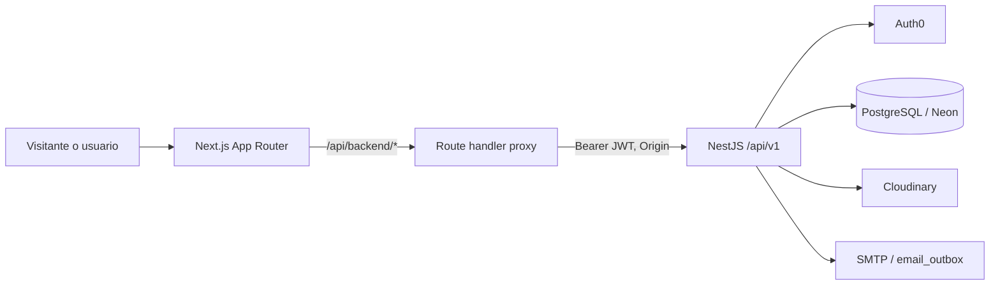

<!-- responsable: Braian | estado: implementado parcialmente; fuente: BackEnd/backendsana y FrontEnd/sana -->
# 5. Arquitectura y patrones de diseño

## 5.1 Estilo arquitectónico vigente

SANA es una aplicación cliente-servidor. Next.js implementa experiencia, sesión Auth0 y un **BFF mínimo**; NestJS es fuente de verdad para dominio, autorización y persistencia. La API es REST/JSON y PostgreSQL-Neon conserva el estado transaccional.

El BFF no reproduce autorización ni reglas de negocio: reenvía token cuando hay sesión y NestJS decide. Un enlace o layout de Next no sustituye guards ni autorización a nivel de registro.

## 5.2 Capas backend

| Capa | Responsabilidad permitida | No debe hacer |
|---|---|---|
| Controller | Ruta, guards, DTO, código HTTP, extraer identidad/params y delegar. | SQL, lógica extensa o confiar en IDs del body. |
| Guard | JWT, origin, rate limit y rol. | Sustituir propiedad/asignación del recurso. |
| Service | Casos de uso, estados, propiedad, transacciones y errores de dominio. | Conocer UI. |
| Repository | TypeORM/SQL, bloqueo y persistencia. | Resolver permisos de interfaz. |
| DTO/entity | Contrato validable y almacenamiento. | Convertirse en un servicio. |

La identidad sensible se deriva de `request.user` validado, nunca de un `userId`, `psyId` o `requesterId` controlado por cliente.

## 5.3 Módulos existentes

| Módulo | Responsabilidad actual |
|---|---|
| `auth` | Verifica Auth0, sincroniza identidad, sesión y términos. El backend no emite JWT propio. |
| `users` | Usuarios internos, roles, estados y perfil propio. |
| `appointments` | Solicitud pública, asignación, confirmación, descarte, cancelación y finalización. |
| `schedule` | Bloqueos puntuales/recurrentes, calendario y disponibilidad. |
| `consultants` | Ficha administrativa y vistas restringidas para psicología. |
| `clinical-notes` | Registro, historial y auditoría de notas clínicas. |
| `policy` | Documento vigente y evidencia de aceptación por solicitud, agenda o nota. |
| `content` | Institucional, tarjetas, noticias, banners, galería y Cloudinary. |
| `security-logs` | Rechazos por rol. |
| `email` | Outbox SMTP, locks, reintentos y borrado de payload enviado. |

No existen módulos implementados de donaciones, reportes ni WhatsApp. No inventar rutas o tablas sin contrato y decisión funcional aprobados.

## 5.4 Patrones y reglas

| Patrón | Aplicación | Regla |
|---|---|---|
| Módulos Nest + DI | Providers por constructor. | Registrar provider/export/import; no usar `new` para servicios. |
| Repository | Acceso encapsulado en módulos de dominio. | SQL fuera de controladores; transacción cuando varios registros cambian juntos. |
| DTO + validación | `class-validator`/transformer. | DTO específico si cambia semántica de creación, edición o transición. |
| Guards/decoradores | `JwtAuthGuard`, `RolesGuard`, `OriginGuard`, `@Roles`, `@RateLimit`. | La protección de servidor es obligatoria; rol de método prevalece sobre clase. |
| BFF | `app/api/backend/[...path]/route.ts`. | Delgado: sin dominio ni secretos de terceros en cliente. |
| Feature-first | `pages`, `components`, `hooks`, `services`, `types`, `validation`. | La ruta compone; la feature implementa. |
| Outbox | `email_outbox`. | Encolar con el evento cuando la notificación sea indispensable. |
| Auditoría | Logs de seguridad, notas, contenido y asignaciones. | Actor, instante, recurso y acción mínimos; no datos sensibles completos. |

## 5.5 Invariantes transversales

- Una cita tiene un único paciente: solicitante **o** dependiente. Transición y ocupación/liberación de agenda deben ser atómicas.
- Psicología solo opera sus relaciones, citas y notas asignadas; secretaría no recibe observación clínica.
- Contenido público usa proyecciones públicas: publicado/activo. Nunca reutilizar respuesta administrativa.
- La imagen se carga directo a Cloudinary con firma; solo persisten URLs verificadas del folder, formato y tamaño permitidos.
- Aceptaciones de política son evidencia histórica: cada solicitud y nota tiene la suya; la de agenda es única por persona-versión.
- Estados son contrato: no añadir ni transitar estados sin actualizar API, BD, UI, pruebas y documentación.

## 5.6 Decisión de extensión

Antes de una capacidad nueva: delimitar caso de uso y datos sensibles; definir DTO/errores/roles en sección 9; entidad/migración e invariantes en sección 6; servicio y autorización de registro; endpoint; feature frontend; y pruebas de permisos, validación y transición. Si falta una decisión de producto, registrar un marcador de confirmación; no inventarla.
