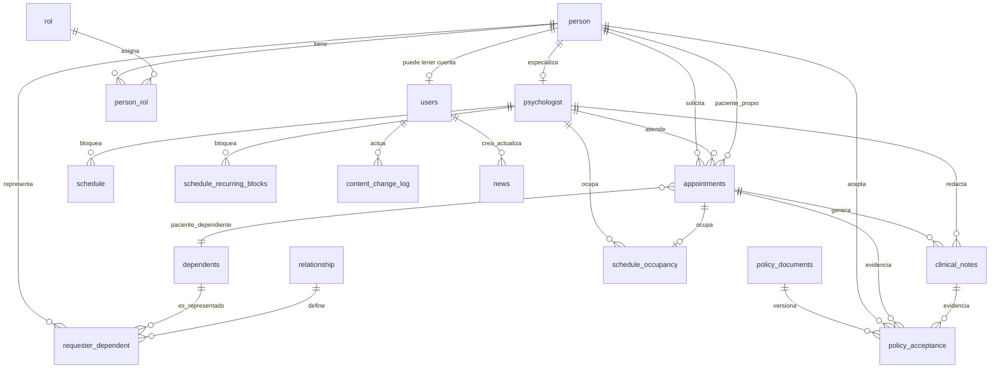

<!-- responsable: Braian | estado: implementado parcialmente -->
# 6. Modelo de datos

## 6.1 Alcance y fuente de verdad

La fuente de verdad del esquema desplegable es `DataBase/init-scripts/03-schema-NEON.sql`, incluidas sus migraciones incrementales al final. Las entidades TypeORM expresan el modelo de aplicación, pero ante divergencia se debe inspeccionar primero el SQL efectivo y corregir la discrepancia; no deducir tablas de las historias de usuario.

El esquema usa `public`, claves enteras y timestamps `timestamptz`. Los nombres físicos tienen prefijos históricos (`per_`, `app_`, `cn_`); el API los convierte a nombres camelCase. No exponer nombres de columnas ni filas completas de tablas como contrato público.

## 6.2 Mapa entidad-relación

La notación de paciente propio/dependiente representa una XOR de negocio: `appointments` debe tener exactamente uno de `app_patient_person_id` o `app_patient_dependent_id`. El SQL inicial exigía “al menos uno”; el servicio debe preservar además la exclusión mutua.

## 6.3 Identidad, acceso y personas

| Tabla | Finalidad y campos relevantes | Restricciones/invariantes |
|---|---|---|
| `person` | Persona base: nombre, documento, correo, contacto, estado, fecha de actualización; migraciones agregan tipo de documento, nacimiento, género, vulnerabilidades, zona y login. | Documento único; correo único case-insensitive (`lower(per_email)`); estados físicos históricos `activo/inactivo/bloqueado`. Convertir a los estados expuestos por API solo en el mapeo. |
| `users` | Cuenta vinculada 1:1 a `person`: `use_id`, proveedor/sub Auth0, refresh-token hash y `user_last_login_at`. | PK/FK compartida con `person`; `(user_provider_id,user_provider_name)` único. No guardar tokens de acceso en texto plano. |
| `rol` | Catálogo de roles. | Los valores de aplicación vigentes están en sección 3; no inferirlos por ID. |
| `person_rol` | N:M persona-rol, con asignación y estado activo. | PK compuesta `(per_id, rol_id)`; soporta múltiples roles. |
| `psychologist` | Extensión profesional: licencia, especialidad y términos de agenda. | PK/FK `psy_id -> person.per_id`, por lo que puede existir antes de tener fila `users`. |
| `auth_sessions` | Metadatos de sesión/auditoría de autenticación. | Se relaciona a usuario; no exponer al cliente. |
| `security_access_log` | Intentos autenticados de acceso con rol insuficiente. | Conserva actor, roles, sección, instante y referencia de sesión; lectura administrativa. |

Una cuenta, una persona y un consultante no son sinónimos: una persona puede no tener cuenta, un psicólogo puede existir antes del primer inicio Auth0 y un dependiente no se modela como `person`.

## 6.4 Consultantes, dependientes y citas

| Tabla | Finalidad y campos relevantes | Restricciones/invariantes |
|---|---|---|
| `dependents` | Menor/dependiente: documento, nombre, contacto, nacimiento; migraciones agregan tipo documento y género. | Documento único. Tratar como dato sensible de menor. |
| `relationship` | Catálogo de parentesco. | `requester_dependent.rel_id` es opcional; no convertirlo en texto libre. |
| `requester_dependent` | Relación solicitante–dependiente y parentesco. | PK `(req_id,dep_id)`; evita duplicar el vínculo. |
| `appointments` | Solicitud/cita: solicitante, paciente, psicólogo/secretaría, fecha, duración, tipo, estado, motivo, creación y descarte. | El servicio valida transiciones, asignación y disponibilidad. Índices por estado, solicitante, psicólogo, creación y paciente realizado. |
| `appointment_assignment_history` | Reasignaciones: psicólogo anterior/nuevo, secretaria, motivo e instante. | Es historial inmutable de asignación, no el estado actual. |

Estados de cita existentes en código/BD: `solicitada`, `asignada`, `confirmada`, `realizada`, `cancelada`, `descartada`. Usar exactamente estos valores en persistencia y contratos; no sustituir `descartada` por un borrado físico. La API pública crea solicitud sin exigir sesión; las operaciones posteriores deben derivar actor y alcance del JWT.

## 6.5 Agenda y disponibilidad

| Tabla | Semántica | Regla |
|---|---|---|
| `schedule` | Bloque puntual de indisponibilidad del psicólogo (`fecha`, inicio, fin, cita opcional). | Fin posterior a inicio. El campo histórico de motivo fue eliminado. |
| `schedule_recurring_blocks` | Bloque semanal recurrente, con día de semana, franja y rango opcional de vigencia. | Fin posterior a inicio; pertenece al psicólogo. El motivo fue eliminado. |
| `schedule_occupancy` | Intervalo ocupado por cita o bloqueo manual, con `source_type`, fecha y horas. | `source_type` es `appointment` o `manual`; una cita produce a lo sumo una ocupación (`app_id` único parcial). |

La disponibilidad mostrada se calcula como la oferta/ventana aplicable menos `schedule_occupancy`; no tratar `schedule` y ocupación como la misma cosa. Al confirmar/asignar/cancelar/descartar una cita, actualizar cita y ocupación de forma atómica para evitar doble reserva. Los índices `(psy_id, occ_date, occ_start_time)` y de cita existen para estas consultas.

## 6.6 Notas clínicas, consentimiento y auditoría

| Tabla | Finalidad | Restricciones/invariantes |
|---|---|---|
| `clinical_notes` | Nota de atención: cita, psicólogo, observación y creación. | Solo el psicólogo asignado puede crear/ver mediante servicio; observación es dato de salud sensible. |
| `clinical_notes_audit` | Trazabilidad de acceso/acción sobre la nota: nota, psicólogo, fecha e IP. | No sustituye la nota ni expone contenido. |
| `policy_documents` | Versiones de políticas: tipo, versión/texto, vigencia y estado. | Obtener la versión vigente, no una cadena hardcodeada en cliente. |
| `policy_acceptance` | Evidencia: persona, dependiente opcional, nota opcional, cita opcional, documento, IP e instante. | Unicidad por `(app_id,pd_id)` para solicitud y `(cn_id,pd_id)` para nota; aceptación propia de agenda única por persona-versión cuando no está ligada a cita/dependiente/nota. |

No sobrescribir una aceptación al cambiar una política. Una solicitud de cita exige su aceptación de la versión vigente, incluso para la misma persona; una nota exige la suya. Las APIs que devuelvan historias o reportes deben proyectar el mínimo necesario y jamás usar estas tablas para revelar consentimiento de terceros.

## 6.7 Contenido y medios

| Tabla | Finalidad | Restricciones/invariantes |
|---|---|---|
| `content_items` | Valores institucionales únicos (por ejemplo misión y visión), valor y último editor. | Clave indexada; autor FK a usuario. |
| `content_cards` | Valores, equipo, servicios y programas. | Sección: `values`, `team`, `services`, `programs`; imagen implica texto alternativo; orden e indicador activo. |
| `news` | Noticias Markdown limitado, imagen, estado, publicación, fijación y autores. | Estado `published`/`retired`; solo una fijada; una fijada debe estar publicada; imagen implica alt. |
| `gallery_images` | Imagen, alt, leyenda, orden, estado y autores. | Estado `published`/`retired`; alt obligatorio. |
| `banners` | Título, imagen/alt, activo y autores. | La migración más reciente eliminó vigencias; activo requiere imagen. Máximo activo se aplica por configuración/servicio, no por una restricción SQL visible. |
| `content_change_log` | Actor, tipo de contenido, ID, acción e instante. | Tipos/acciones enumerados; es trazabilidad, no versionado completo de contenido. |

La BD guarda URL de Cloudinary, no binarios. Antes de persistir, el backend valida que la URL pertenezca al cloud/folder del proyecto y que cumpla formato/tamaño permitido. El sitio público únicamente lee registros publicados/activos mediante endpoints públicos.

## 6.8 Operación técnica y alcance no implementado

| Tabla | Uso |
|---|---|
| `email_outbox` | Cola para Gmail API: destinatario/asunto/cuerpo mientras está pendiente; estado (`pending`, `sending`, `sent`, `failed`), intentos, lock, próximo intento y resultado. Al quedar `sent` o `failed`, el check exige borrar destinatario y contenido. |
| `donors`, `donations`, `payment_method` | Existen en el SQL heredado para donaciones, pero no tienen módulo/API/frontend implementado actual. No exponer ni extender sin contrato de donaciones aprobado. |

## 6.9 Reglas de evolución

- DB-01. Todo cambio se agrega como migración SQL idempotente y revisable en el esquema de Neon; no editar datos productivos manualmente ni depender de `synchronize: true`.
- DB-02. Una migración preserva datos y establece valores/backfill antes de volver una columna obligatoria o añadir una FK/check.
- DB-03. Nombrar explícitamente PK, FK, índices y checks; crear índices desde los patrones reales de consulta, no por intuición.
- DB-04. Usar transacciones para cambios de estado que afecten cita, ocupación, historial, aceptación o outbox.
- DB-05. Semillas contienen solo datos ficticios. Documentos, correos, teléfonos, IP, consentimiento y notas clínicas requieren minimización, proyección por rol y no se incluyen en logs/fixtures compartidos.
- DB-06. Cualquier tabla/columna/estado nuevo exige entidad/repository, DTO y mapeo, autorización, prueba de migración y actualización de las secciones 3 y 9.
